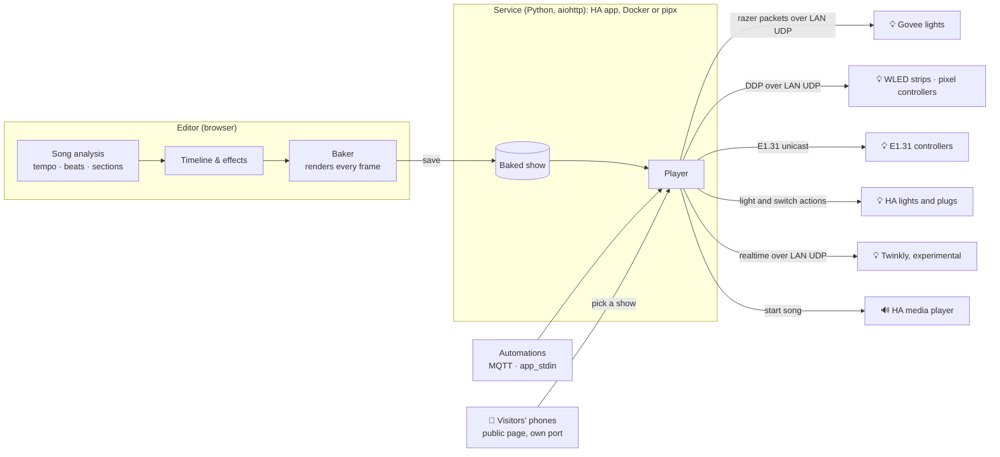

<div align="center">


**Music-synchronised light shows for the lights you already have, made for Home Assistant.**

A simple alternative to xLights for Govee lights, WLED strips, pixel controllers, Twinkly and any Home
Assistant light: design a show in your browser, watch it play on a photo of your house, then run it from
an automation. Install it as a Home Assistant app (formerly called an add-on), or run it on
its own with Docker or Python.

<sub>A hobby project, written almost entirely by AI. See [How this is made](#-how-this-is-made).</sub>

[](https://github.com/gdeboos/ha-liday-show/actions/workflows/ci.yml)
[](haliday_show/CHANGELOG.md)

[](LICENSE)
[](#-how-this-is-made)

[](https://my.home-assistant.io/redirect/supervisor_app/?app=5aa48a95_haliday_show&repository_url=https%3A%2F%2Fgithub.com%2Fgdeboos%2Fha-liday-show)

[Install](#-installation) · [Features](#-features) · [User guide](docs/guide/README.md) ·
[Changelog](haliday_show/CHANGELOG.md) · [Development](#-development)


</div>

## ✨ Highlights

- 🎵 **Hears the song for you.** Tempo, beats, bars and sections (intro, verse, chorus…) are detected
  in your browser as soon as you add a song, and every effect snaps to them.
- 🪄 **A first draft in one click.** **Generate** fills your lights with effects that follow the
  music, in the palette and style you pick, building up the way you would by hand: a few lights in
  quiet parts, every light in the chorus. Ready for you to tweak.
- 💬 **Or just describe it.** "Red and green chase on the roof in every chorus" and an AI adds it,
  using Claude or any AI you've set up in Home Assistant, local models included.
- 🏠 **See it on your house.** Trace your lights on a photo and the editor plays the show there,
  bulb by bulb, so you can design without standing in the garden.
- 🔌 **Works with the lights you have.** Govee, WLED, pixel controllers over DDP or E1.31, Twinkly, and
  any Home Assistant light or smart plug, all in one show.
- 📦 **Plan before you buy.** Add lights that haven't arrived yet and link them to the real ones later.
- ⏯️ **Runs itself.** Put shows in a playlist that plays every evening, at set times or from sunset.
  The music plays on any Home Assistant speaker, or in a browser left open on a computer with
  speakers. Automations can start shows too, through MQTT entities or `hassio.app_stdin`.
- 📱 **Let passers-by join in.** A public page for a QR code on a sign: people near your house pick a
  show on their phone and it joins a queue between your own, in a look you choose.
- 🐳 **Runs where you want.** A Home Assistant app, or on its own with Docker or Python.

## 📸 A closer look

<table>
  <tr>
    <td width="50%"></td>
    <td width="50%"></td>
  </tr>
  <tr>
    <td><b>Pick an effect.</b> Suggestions fit the part of the song you selected, and every button
    previews the effect on that light.</td>
    <td><b>Trace your house.</b> Lines, icicles and spotlights, each drawn bulb by bulb from the plug
    end.</td>
  </tr>
</table>

## 🚀 Installation

**Lights**, in any mix, on the same network as wherever HA-liday Show runs:

| Kind | What you need |
| --- | --- |
| Govee | **LAN Control** turned on in the Govee Home app, and a model with Govee's per-segment realtime mode |
| WLED | Any WLED strip |
| Pixel controllers | DDP (Falcon Player, ESPixelStick, ESPHome, Tasmota, ESP32) or E1.31/sACN (Falcon, Kulp, xLights set-ups) |
| Home Assistant | Any light or switch, such as Zigbee or Hue bulbs, or a smart plug for a prop |
| Twinkly | Experimental: not tried on a real Twinkly yet |

### As a Home Assistant app (recommended)

Apps were called add-ons before Home Assistant 2026.2. You need Home Assistant OS or Supervised
(anything with **Settings → Apps**).

1. Press **Show app on My Home Assistant** above. It opens your Home Assistant, offers to add this
   repository, then opens the **HA-liday Show** page.
   <details><summary>Adding it by hand</summary>

   Go to **Settings → Apps** and press **Install app** to open the **App store**. Open the ⋮ menu,
   choose **Repositories** and add `https://github.com/gdeboos/ha-liday-show`. Then find
   **HA-liday Show** in the store.
   </details>
2. Press **Install**, turn on **Show in sidebar**, and start it.
3. Open **HA-liday Show** from the sidebar and follow the
   [quick start](docs/guide/getting-started.md#quick-start).

Home Assistant builds the app on your machine the first time, which takes a few minutes. For show
entities in automations, also set up the Mosquitto broker app and the MQTT integration (optional).

### Without Home Assistant apps

If your Home Assistant can't install apps (a "Container" or "Core" install), or you don't use Home
Assistant at all, run it on any always-on machine on your network instead:

- **[With Docker](docs/guide/without-home-assistant.md#with-docker)** on a NAS, Raspberry Pi or Linux PC, with the
  ready-made [`docker-compose.yml`](standalone/docker-compose.yml).
- **[With Python](docs/guide/without-home-assistant.md#with-python)** on a Mac, Linux or a Raspberry Pi:
  `pipx install git+https://github.com/gdeboos/ha-liday-show`

It's the same app with the same saved files, so shows copy across. You open it in a browser with a
password, and it can still use your Home Assistant speakers, AI and MQTT if you point it at them. See
[Running without Home Assistant](docs/guide/without-home-assistant.md).

## 🧰 Features

<details open>
<summary><b>💡 Lights</b></summary>

- One **Add a light** window for every kind: pick what you're adding and fill in only what it needs
- **Govee** lights, found on the network, with a test pattern and a few yes or no questions to set
  their segments
- **WLED** strips, found on the network or added by IP, with their LED count and WLED segments filled
  in for you
- **Pixel controllers** over DDP (Falcon Player, ESPixelStick, ESPHome, Tasmota, ESP32) or E1.31/sACN
  (Falcon, Kulp, xLights set-ups), with several lights on one controller
- Any **Home Assistant** light or switch (Zigbee, Hue, LIFX bulbs, smart plugs for inflatables), put
  back as it was after the show
- **Twinkly** lights (experimental), through Twinkly's local realtime mode
- Set each light's segments, bulb count, brightness and direction, and **Test** it on the real light
- Dim a whole show, or one light in it, from the show's settings, on top of each effect's own brightness
- Plan shows before your lights arrive: add planned lights by name and segment count, then link
  them to the real lights later
- Put your lights in any order (drag them on the Devices tab) and every show's timeline follows
- Split a light into parts (say, the front, side and back of a roof line) that each get their own
  track, while the light's own track still plays across all of them as one; segments in no part
  stay off during the show. **Test** a part to see exactly where it starts and ends on the real light
- For Govee lights whose realtime mode only reaches part of them, such as the Christmas String Lights 2
  and icicle lights: per-bulb colour (experimental), using the Govee app's own Finger sketch pictures

</details>

<details open>
<summary><b>🏠 Your house</b></summary>

- See the show on a photo of your house: trace where each light runs and the editor plays it there,
  bulb by bulb
- No photo yet? A drawn sample house stands in, and one button puts your lights on its roof, porch,
  windows and tree
- **Try the demo**: seven planned lights on the sample house, a sample song and a show ready to play,
  in one press, with no lights needed
- A setup guide on first run: lights, a speaker, the house, then a first show generated from a song
- **Share** a show as a small file, and **Import** one someone shared: pick your copy of the song,
  then match their lights to yours (suggested by kind, size and where they are on the house), and
  preview it on your house photo before importing
- **Export** and **Import** everything in one file, or **Start afresh**, with a copy kept first so it
  can be undone
- Draw icicle lights as hanging drops and spotlights as beams aimed at the wall
- Mark stretches that run out of view (round a corner, or an extension lead) so the bulb count
  still lines up; those bulbs still play in the real show
- Pin segments to where they really are when the photo is taken at an angle
- A sidebar lists every light so houses with many lights stay manageable

</details>

<details open>
<summary><b>🎬 Building a show</b></summary>

- Detect the song's tempo, beats, bars and sections automatically, in the browser, with a note on
  each section saying what it sounds like and how to light it (written by the AI, if you have one)
- Generate a first draft of a whole show from the song in one click, in a palette and style you pick,
  building up like a person would (a few lights in quiet parts, all of them in the chorus), with a
  limit on how long one effect runs; with an AI, a window shows it working and Cancel stops it
- Describe effects in words and an AI adds them, using Claude with your API key or any AI set up in
  Home Assistant, including local ones
- Effect suggestions for the selected part of the song, timed to its tempo
- Timeline editor with the song's waveform, one track per light, beat markers and snapping, and
  smooth zoom (+/−, Ctrl+wheel or pinch) and scroll
- 15 effects on each light (solid, two and three colours, pulse, gradient, colour cycle, fade, chase,
  rainbow, comet, scanner, flicker, lightning, strobe, twinkle, wipe) with live, segment-level
  previews, built-in presets for each, and your own presets saved from any clip
- A **House** lane for effects that run across all your lights by where they are on the photo, like
  xLights' model effects: sweeps, wipes and rainbow waves in any direction
- Colour palettes for holidays and moods, plus your own (or ones the AI makes from a description), to
  recolour an effect, a light or the whole show in one click
- Copy and paste effects between lights, play and loop just a region, undo and redo
- A **Playlist editor**: drag shows into a running order, with building blocks between them (a pause,
  one colour, lights off or an effect), and a bar showing how long each plays
- **Scenes**: one-tap looks for the whole house, like the Govee app's, that play until you choose
  something else and come back after a show. Build them in the **Scene editor**, light by light or
  the same for every light
- **Scenes**: one-tap looks for the whole house, like the Govee app's, that play until you choose
  something else and come back after a show. Build them in the **Scene editor**, light by light or
  the same for every light
- Playlists: several shows back to back, round and round, by hand or on a schedule (times or
  sunset, days and dates), with a Show player page to play the music on any computer with speakers
- Knows what each light can show: effects that won't work on a light (a chase on a light that shows one
  colour at a time) are greyed out in the chooser, such clips in older shows are marked on the timeline,
  and previews step at a slow light's own pace so they look like the real thing
- **Your shows**: the Show editor starts on a list of your shows (also under Library → Shows), to open, duplicate or rename
- **Library → Songs**: every song, whether it's detected and which shows use it, with a search and Edit in the Music editor
- **Archive or delete** shows and songs, with a way back: archived ones can be restored, and shows using a song can take another one
- Add a song in one window (name it, upload it, detect it); big songs go up in pieces, so files over
  Home Assistant's 16 MB limit upload fine
- Cut, trim and splice songs in the **Music editor**, with crossfades, as named **drafts** kept as you go that you can come back to and tweak, then make into a song file
- **Even out the volume** when making a song file, so songs play at about the same loudness
- **Layers** in the Music editor: samples or songs played over a song, pinned to the music so they follow cuts, mixed into the song file, optionally quietening the song under them
- **Mixer** in the Music editor: bass, mid and treble faders on the song and each layer, changing partway through, and layers matched to the song's tempo, for mash-ups
- **Samples**: short sounds (sleigh bells, a "ho ho ho") to layer over songs, made from part of a song or added as files
- **Suggest cuts**: shorten the song or one section to a length you pick, by whole bars where the join isn't heard; with an AI, it picks the best and says why
- **Marks**: flag and name moments in a song (a big hit, the bells coming in); every show using the song sees them and clips snap to them
- A volume slider for the song while you edit, in the **Show editor** and **Music editor**
- **? Help** on every page: tips for the page you're on, a ? on each editor panel, search, and links into the guide
- Arrange the Show, Music and Playlist editors your way: pick a page layout, then drag, collapse or hide any panel
- The browser's Back and Forward buttons move between the app's pages, inside Home Assistant too
- Experimental: hand a Govee light to one of Govee's built-in scenes for part of the show

</details>

<details open>
<summary><b>▶️ Playing it</b></summary>

- Save and load shows, with auto save; each show is baked into precomputed frames for reliable playback
- Play the song on any Home Assistant media player (with a per-speaker delay), or in the browser
- Schedule or trigger shows from automations: MQTT entities (show select, play/stop buttons,
  status), or the `hassio.app_stdin` action
- Playlists play by themselves at set times or from sunset, carrying on with the page closed
- A **public page** for people passing by, on its own port, with its own **Public page** tab:
  - They pick a show or playlist on their phone and it joins a queue, slotting in between your
    playlist's shows; one request per phone and a queue limit keep it fair
  - A printable A4 sign with a QR code, your title, opening hours and a message
  - A code in the link (the QR code on the sign) and a nearby-only location check keep it to people
    near your house; **Start** only appears once they're close enough
  - Opening hours (set times or from sunset, chosen days), telling visitors when to come back; each
    show or playlist can also have dates every year, and shows as coming soon until then
  - Guides for putting it online with Cloudflare Tunnel, Tailscale Funnel or your own proxy, or
    keeping it to your Wi-Fi
  - Your own title, welcome, picture, colour theme or your own colours (with a readability check),
    spacing, corners, text size, falling snow and a link, with a live preview beside the settings
  - Kept safe: only the visitors' page is on its port, each phone has its own request limit, and
    photos are shared without where they were taken

</details>

The full walkthrough is in the **[user guide](docs/guide/README.md)**, a page per chapter. The same guide
is on the app's **Documentation** tab in Home Assistant, all on [one page](haliday_show/DOCS.md).

## ⚙️ How it works



One Python service (aiohttp) serves the editor and plays shows. As an app it is reached only through
Home Assistant ingress; run on its own (Docker or pipx) it answers its own port, and other devices need
the password set in `HALIDAY_SHOW_PASSWORD`. The public page for visitors is a separate small web app
on its own port (18099) that serves only that page and its queue, never the editor.
Effects are written once, in JavaScript: the editor uses them for the live preview and, on save,
renders every frame of the show into a compact baked file. The player only streams those frames, each
light in its own protocol and at the pace it can take: Govee lights over Govee's undocumented
per-segment "razer" LAN protocol (or its slower app commands, for lights whose realtime mode falls
short), WLED and DDP controllers over DDP, E1.31 controllers over unicast E1.31, Home Assistant lights
and switches through Home Assistant's actions, and Twinkly over its realtime mode. Each kind gets its
own rate limiting and keepalive, and lights set up over HTTP are put back as they were afterwards. It
follows either the browser's audio position or, for a Home
Assistant speaker, starts the lights when the speaker reports it is playing (plus that speaker's
delay) and corrects large drift from its reported position.

## 🛠️ Development

```sh
pip install -r haliday_show/requirements.txt pytest pytest-aiohttp
python -m pytest
node --test tests/js/*.mjs
```

Run the service locally (requests from this machine are allowed without ingress):

```sh
cd haliday_show/app
HALIDAY_SHOW_CONFIG=/tmp/gs/config HALIDAY_SHOW_MEDIA=/tmp/gs/media python -m halidayshow
# then open http://localhost:8099/ (HALIDAY_SHOW_PORT changes the port)
# Optional: HA_URL=http://homeassistant.local:8123 HA_TOKEN=<long-lived token> to use real speakers
```

To try it the way people run it without Home Assistant: `pipx install .` then
`HALIDAY_SHOW_PASSWORD=pw haliday-show` (data goes in `~/haliday-show/`), or build the app image
and run it with `--network host`, as [`standalone/docker-compose.yml`](standalone/docker-compose.yml) does.

No lights to hand? Add planned lights on **Setup → Devices** and everything except the real output
works. To try it in Home Assistant, copy the `haliday_show` folder into `/addons` (Samba or SSH app),
then press **Check for updates** in the **App store**; it appears as a local app and builds on your machine.

**Releasing:** bump the version in `pyproject.toml`, `haliday_show/config.yaml` and
`haliday_show/app/halidayshow/__init__.py` together (CI checks they match), and add an entry to
[`CHANGELOG.md`](haliday_show/CHANGELOG.md). Merging to `main` also publishes the Docker image to
`ghcr.io/gdeboos/ha-liday-show` (`latest` and the version) for standalone installs.

<details>
<summary><b>Repository layout</b></summary>

```
repository.yaml                         Home Assistant app repository metadata
pyproject.toml                          Version, test settings, and the pipx install (haliday-show command)
standalone/docker-compose.yml           Running without Home Assistant, with Docker
.github/workflows/ci.yml                Tests, versions, app image, standalone and pipx checks
.github/workflows/publish.yml           Publishes the image to ghcr.io for Docker installs
docs/images/                            Screenshots for the README
docs/brand/                             Logo, icon and favicon (SVG originals; the app's PNGs are made from them)
haliday_show/                             The app (config, Dockerfile, docs, changelog)
  README.md                             Intro shown on the app's Info tab
  DOCS.md                               User guide (shown on the app's Documentation tab); the one to edit
  CHANGELOG.md                          What changed in each version
  icon.png, logo.png                    Pictures shown in the App store (from docs/brand)
  app/halidayshow/__main__.py             Entry points (app and haliday-show) and environment settings
  app/halidayshow/protocol.py             Govee LAN and razer packet encoding
  app/halidayshow/wled.py                 WLED and DDP: packets, the light's name, LEDs and segments, and the scan
  app/halidayshow/e131.py                 E1.31 (sACN) packets and each controller's shared universes
  app/halidayshow/twinkly.py              Twinkly (experimental): HTTP login and modes, realtime packets
  app/halidayshow/discovery.py            Govee multicast scan (WLED's scan is in wled.py)
  app/halidayshow/listen.py               Records other Govee traffic (Labs → Listen)
  app/halidayshow/lab.py                  Packet lab: hand-made messages to one Govee light
  app/halidayshow/output.py               Streaming to each kind of light: pace, keepalive, putting back, test pattern
  app/halidayshow/baked.py                Baked show file format
  app/halidayshow/player.py               Plays baked frames against a movable clock
  app/halidayshow/playlists.py            Saved playlists and their building blocks: checking them, finding one by name
  app/halidayshow/schedule.py             Starts and stops playlists at their scheduled times
  app/halidayshow/sun.py                  Sunset times, for playlists that start at sunset
  app/halidayshow/runner.py               Starts shows on a speaker or for the browser, plays playlists and visitors' requests
  app/halidayshow/public.py               The public page on its own port: visitors' choices and their queue
  app/halidayshow/imagemeta.py            Takes the GPS location and other hidden details out of photos visitors see
  app/halidayshow/scenes.py               Govee scene library lookup (experimental scenes)
  app/halidayshow/scenelib.py             Your scenes (Scene editor): checking them as they're saved
  app/halidayshow/scenelib.py             Your scenes (Scene editor): checking them as they're saved
  app/halidayshow/storage.py              Shows, settings, songs and the house photo on disk
  app/halidayshow/backup.py               Export, import and start afresh, with copies kept first
  app/halidayshow/archive.py              Archiving, restoring and deleting shows and songs
  app/halidayshow/ha.py                   Home Assistant API (media players, lights and switches, MQTT details)
  app/halidayshow/commands.py             Automation commands over app stdin
  app/halidayshow/mqtt.py                 MQTT discovery entities
  app/halidayshow/server.py               HTTP API for the editor; who may connect (ingress or password)
  app/halidayshow/migrate.py              One-time copy of saved data from the old Govee Light Show add-on
  app/halidayshow/ai.py                   Describe it, AI presets, palettes, section notes and the pick of suggested cuts: asks Claude or HA's AI Task
  app/halidayshow/static/                 The editor (plain ES modules, no build step)
    index.html, style.css               Page and styles
    player.html                         The Show player page
    sign.html, js/sign.js               The printable sign with the QR code (made by segno)
    public/                             The public page visitors see (the only files served on its port):
                                        index.html, public.js and public.css; colours.js has the
                                        readability sums shared with the editor
    js/app.js                           Editor state, panels, inspector and playback
    js/effects.js                       Effect definitions, House lane effects and the baker
    js/timeline.js                      Timeline canvas: waveform, clips, selection, zoom
    js/help.js                          The Help drawer's words: tips per page and panel, search
    js/helpui.js                        The Help drawer and the editors' ? bubbles
    js/house.js                         House photo: tracing, bulb layout, icicles, spots
    js/samplehouse.js, sample-house.svg  The sample house and its ready-made places for lights
    js/demo.js, sample-song.mp3         Try the demo: its planned lights and the music-box song
    js/devicetest.js                    Frames for testing a light's parts on the Devices tab
    js/labtemplates.js                  Packet lab starting points
    js/layout.js                        Movable panel layout
    js/palettes.js                      Colour palette presets
    js/schedule.js                      A playlist's schedule in words
    js/playlisteditor.js                Playlist editor: where a dragged card lands, running time, building blocks
    js/sceneeditor.js                   Scene editor and Your scenes: rows per light, preview, saving and baking
    js/housescenes.js                   A scene's sums: what each light plays, its loop, its row's colours
    js/showbright.js                    Show settings → Brightness: the whole show and each light in it
    js/publicsettings.js                The Public page tab: its address, dates and queue in words
    js/sectionnotes.js                  Notes for song sections, from what each sounds like
    js/showplayer.js                    Show player: plays songs of shows started with no speaker
    js/music.js                         Music editor: cutting, trimming and splicing songs
    js/cutfinder.js                     Suggest cuts: where whole bars can go without the join being heard
    js/drafts.js                        Keeps the Music editor's drafts on the server as you edit
    js/loudness.js                      How loud a song is, and evening it out (Make song file)
    js/layers.js                        Layers: clips pinned to the song, mixing them in, and the limiter
    js/mixer.js                         The Music editor's bass, mid and treble faders, with changes that glide
    js/tempo.js                         Matching a layer to the song's tempo, keeping its pitch
    js/volume.js                        The song volume slider shared by the Show editor and Music editor
    js/songload.js                      Fetching a song, and saying plainly why one did not load
    js/statusline.js                    The message spot in the top bar: saved, settled and error states
    js/showlist.js                      Your shows: the rows of the show list (sorting, details, copy names)
    js/songlist.js                      Library → Songs: the rows of the song list and its search
    js/songfolders.js                   Your songs' folders: which songs are in which, and making, renaming and deleting them
    js/analysis.js                      Song analysis: tempo, beats, bars and sections
    js/analysis-worker.js               Runs the analysis off the main thread
    js/autogen.js                       Generates a draft show from the analysis
    js/newshow.js                       The New show window's name and start choices
    js/sharing.js                       Share and Import show: the .halidayshow file, light suggestions, tracks
    js/upload.js                        Sends big songs and baked shows in pieces, under ingress's 16 MB limit
    js/models.js                        Reads models.json: each Govee model's tested status and settings
    js/addsong.js                       The Add a song window's names and messages
    js/lightspeed.js                    How fast each protocol can change a light, and previews at that pace
    js/compat.js                        Whether a clip's effect can show on its light, for marking and blocking
    js/controllers.js                   Pixel controllers (DDP, E1.31): where a new light starts, overlaps
    js/aiclips.js                       Describe it: context for the AI, checking its clips and presets
    models.json                         Our list of Govee lights: tested status and default settings
tools/build_models.py                   Adds new lights from Govee's LAN Control list to models.json
tools/make_sample_song.py               Renders the demo's music-box Jingle Bells (static/sample-song.mp3)
tools/split_guide.py                    Makes docs/guide/ (the guide a page per chapter) from DOCS.md
tools/govee_btsnoop.py                  Decrypts the Govee app's Bluetooth traffic from an Android log
docs/guide/                             The user guide on GitHub, a page per chapter (made from DOCS.md)
docs/README.md                          Index of the notes below, one per kind of light
docs/govee-protocols.md                 How Govee lights are driven: findings, measurements, open questions
docs/capture-help.md                    Capturing the Govee app's traffic, for working out new commands
docs/wled.md                            How WLED strips are driven: DDP, and how WLED segments become parts
docs/ddp.md                             Pixel controllers over DDP: several lights on one controller
docs/e131.md                            E1.31 (sACN) controllers: universes, shared universes, stopping
docs/ha-lights.md                       Home Assistant lights and switches: pace, switching, putting back
docs/twinkly.md                         Twinkly (experimental): login, realtime packets, putting back
docs/public-page-security.md            Security review of the public page: what faces the internet, what was fixed
tests/                                  pytest and node tests (tests/js)
```

</details>

## 🤖 How this is made

HA-liday Show is a hobby project, and almost all of its code is written by AI (Anthropic's Claude), with
a person deciding what to build and trying it on real lights. Every change runs through automated tests
and a test build before it's released. Govee models with a **✓ works** or **⚠ limited** badge in the
model list have been tried on real lights; ones marked **? untested** are best effort. WLED,
pixel controllers, Home Assistant lights and Twinkly have so far only been tested against pretend
devices on the wire, so reports from real ones are especially welcome. If something doesn't work on yours, please
[open an issue](https://github.com/gdeboos/ha-liday-show/issues).

## 📄 Licence

MIT, see [LICENSE](LICENSE). Not affiliated with Govee, WLED, Twinkly or Home Assistant.
