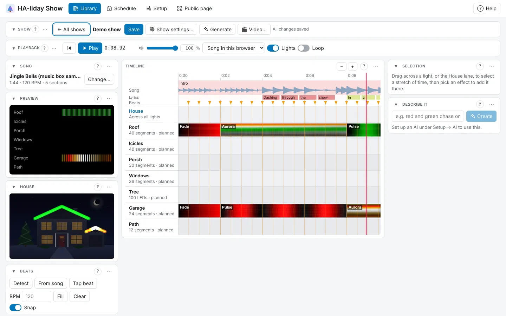

# HA-liday Show user guide

Build music-synchronised light shows for your Christmas lights, preview them on a photo of your house,
and play them from Home Assistant. HA-liday Show drives WLED strips, pixel controllers (DDP or E1.31),
Govee lights, any Home Assistant light or switch, and Twinkly (experimental), in any mix.

New here? Start with **[Getting started](getting-started.md)**, or press **Try the demo** to see it
working before your lights are up. Inside HA-liday Show, **? Help** at the top right has tips for the
page you're on, each with a link to the right part of this guide.

## Start here

- [Getting started](getting-started.md): finding your way, what you need, the quick start and the demo

## Set up, once

- [Adding your lights](lights.md): WLED, matrices, pixel controllers, Govee, Home Assistant lights, Twinkly
- [Parts, groups, roles and seasons](organising-lights.md): split lights, group them, and put props away
- [Speakers](speakers.md): where the music plays
- [Your house](house.md): your photo, with each light traced on it

## Songs

- [Songs and samples](songs.md): adding songs, splitting them into their parts, short sounds to layer
- [The Music editor](music-editor.md): cuts, layers, the mixer, mashups, marks, beats and sections
- [Pictures and faces](pictures-and-faces.md): pictures and GIFs, and your own Singing faces

## Make shows

- [Your shows](shows.md): making, organising, sharing and exporting shows as videos
- [Let it make a show for you](generate.md): Suggestions, Describe it and Generate
- [The Show editor](show-editor.md): the timeline, effects, transitions, presets and palettes
- [Effects](effects.md): every effect, by group

## Play them

- [Playing shows and playlists](playing.md): saving, playing, and shows back to back
- [Scenes](scenes.md): one-tap looks for every light
- [Live music](live-music.md): lights that react to music in the room
- [Schedule](schedule.md): what plays by itself, and when
- [Pre-show check](pre-show-check.md): check everything before the night's shows

## Visitors

- [The public page](public-page.md): a page passers-by open to pick what plays
- [Visitors' queue and voting](queue-and-voting.md): first come, first served, or a vote
- [Visitors' phones](visitors-phones.md): music on their phone, and their screen joining the show

## Home Assistant

- [Home Assistant](home-assistant.md): the integration, sensors, actions, events and MQTT
- [Dashboard cards](dashboard-cards.md): Player, Browse, Scenes, Schedule, Visitors and House cards

## Settings and help

- [Settings and your data](settings.md): the editor's layout, settings, export and import
- [Setting up the AI](ai.md): what uses AI and where it runs
- [Troubleshooting](troubleshooting.md): when something's not right, and where things are kept
- [Running without Home Assistant](without-home-assistant.md): Docker or Python
- [Labs](labs.md): experiments with Govee lights

## Writing this guide

Each page is one topic, written in `docs/guide/` (this folder). The app's **Documentation** tab in Home
Assistant shows `haliday_show/DOCS.md`, a short overview that links here. Screenshots are in
`docs/images/guide/`, made by `tools/screenshots.py`. After changing pages, run
`python tools/check_guide.py --fix`: it checks every link and keeps each page's previous/next line in step
with the order above.
