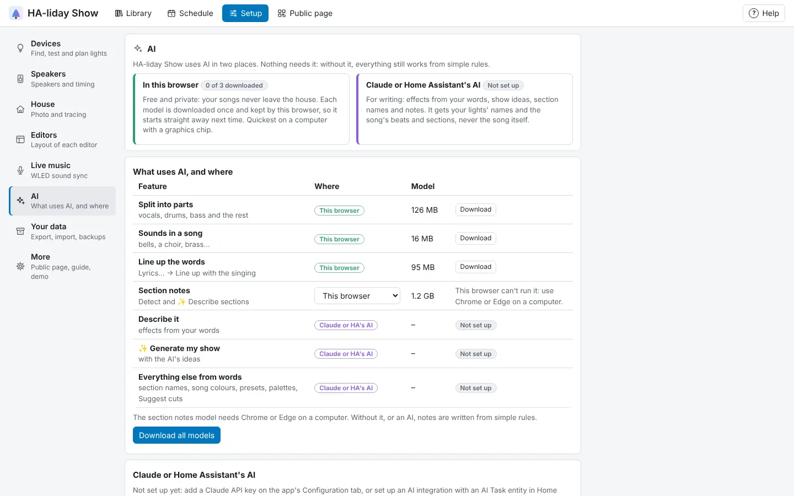

<!-- The user guide is written here, a page per topic. tools/check_guide.py checks its links. -->

# Setting up the AI

What uses AI, where it runs, and how to set it up.

HA-liday Show uses AI in two places, and **Setup → AI** shows both: what each feature uses, where it
runs and whether it's ready. Nothing needs AI: without it, everything still works from simple rules.

**In this browser.** These run on your computer, free, and your songs never leave the house:

| Feature | Model |
|---|---|
| [Split into parts](songs.md#split-into-parts) (vocals, drums, bass and the rest) | 126 MB |
| Sounds in a song (bells, a choir, brass…) | 16 MB |
| [Line up with the singing](effects.md#lyrics-for-a-singing-face) | 95 MB |
| Section notes (optional, see below) | 1.2 GB |

Each model is downloaded the first time it's used and kept by your browser. To have them ready ahead of
time, press **Download** on a row, or **Download all models**; a row shows **✓ Downloaded** once your browser
has it, and the card at the top says how many it has. **Remove them from this browser** frees the space
(they're downloaded again when next used). A browser can only keep them when HA-liday Show is open over
https (as it is through Home Assistant's own address). Otherwise each is downloaded when it's used, and
the rows say so.

**Claude or Home Assistant's AI.** **Describe it**, **✨ Generate my show** with the AI's ideas, section
names, song colours, **✨ Make presets**, **✨ Make palettes** and the AI's pick of
[suggested cuts](music-editor.md#suggest-cuts) need one of these:

- **Claude, with your own API key.** Create a key at console.anthropic.com, then in Home Assistant open
  **Settings → Apps → HA-liday Show → Configuration**, paste it into **Claude API key** and save.
  Each request costs a few US cents on your Anthropic account (it uses Claude Opus 5.5 at low effort).
- **Home Assistant's AI Task**, which uses whichever AI integration you've set up there with an AI Task
  entity: Anthropic, OpenAI, Google Gemini, or a local model through Ollama, which keeps everything on
  your network. If you have several, set **AI Task entity** on the Configuration tab, or Home Assistant's
  preferred one is used. Smaller local models may follow the instructions less well.

With a key and no AI Task, Claude is used; with only an AI Task, Home Assistant's. With both, **Use**
under **Claude or Home Assistant's AI** picks which (Claude, unless you change it). The AI is sent your
lights' names and segment counts, the effect list, the song's tempo, beats and sections, your palettes,
the selection and the effects already on the lights (for suggested cuts: the song's name, sections, notes
and marks, and the cuts found). It's never sent the song itself.

## Section notes on this device

The section notes that **Detect** and **✨ Describe sections** write can come from a small AI model that
runs in your browser instead, so nothing about your songs leaves the house and there's nothing to pay.
Under **Setup → AI**, on the **Section notes** row, press **Download** (1.2 GB). It's a one-off download
(HA-liday Show fetches it and checks it, then your browser keeps it), and it needs a recent browser and
graphics chip: Chrome or Edge on a computer. The row says if yours can't run it, and **Remove** frees the
space again.

The picker on that row chooses which writes them when both are there: **This browser** (the default,
once the model is downloaded in this browser) or **Claude or HA's AI**. The model writes the notes one
section at a time from what was found in each; it doesn't rename sections, which only Claude or Home
Assistant does. The first time in a session it takes a little while to load. Without the model or an AI,
the notes are written from simple rules.
The AI in your browser does one thing at a time on the graphics chip, so notes being written, a song
being split and words being lined up wait for each other rather than running together.
While it downloads, HA-liday Show keeps its own copy in its temporary folder until it next restarts, so
the Home Assistant machine needs about 1.2 GB free for a while.

<!-- nav: made by tools/check_guide.py -->

---

← [Settings and your data](settings.md) · [Contents](README.md) · [Troubleshooting](troubleshooting.md) →
<!-- /nav -->
