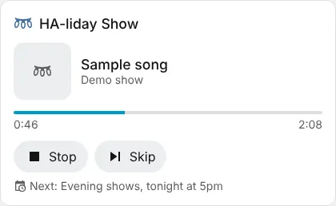
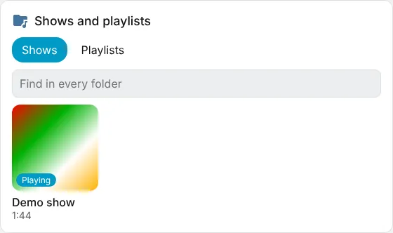
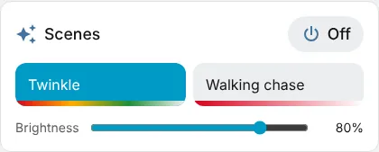
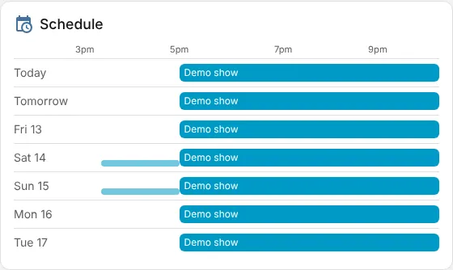
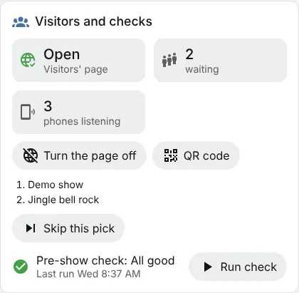
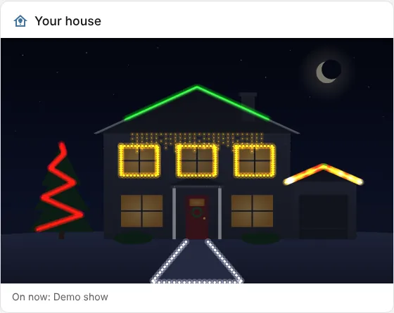

<!-- The user guide is written here, a page per topic. tools/check_guide.py checks its links. -->

# Dashboard cards

HA-liday Show's cards for your Home Assistant dashboards.

The integration comes with cards for your dashboards. Edit a dashboard, press **+ Add card**, and search
for **HA-liday Show**. There are six:

- [Player](#player)
- [Browse](#browse)
- [Scenes](#scenes)
- [Schedule](#schedule)
- [Visitors and checks](#visitors-and-checks)
- [House](#house)

## Player

What's playing, its cover art and how far through it is, and what's next on
the schedule. When nothing's on, pick a show and press **Play**. While a show plays, **Stop** stops it
and **Skip** ends a visitor's pick.

## Browse

Your shows and playlists as tiles, in the same folders as in **Library**.
Press a folder to go in, and the path at the top to come back out. **Find in every folder** searches
them all. Press a show or playlist to play it. A show's tile has its picture, else its song's cover
art, else its palette's colours, and a tag with its season if it has one.

## Scenes

A button for each of your scenes, with a strip of that scene's colours
along its bottom. Press one to put it on; the one that's on is highlighted. **Brightness** dims the scene that's on, and **Off** turns scenes off.

## Schedule

What plays when, from today through the days ahead, as a timeline
with a day on each row, just as your **Schedule** rows will play them (a row that won't get its turn
isn't drawn). Shows and playlists are the tall bars, scenes the thin ones underneath, and a red line
marks now. Press a bar to see its times. On a narrow card it's a list instead.

## Visitors and checks

Whether the visitors' page is open, how many picks are
waiting (or votes, in **Vote** mode) with the next few, how many phones are listening, and how the last
pre-show check went. **Skip this pick** ends the visitor's pick that's playing. **Run check** runs the
pre-show check there and then, and lists anything to fix or look at. **Turn the page on** (or **off**)
switches the visitors' page, and **QR code** shows the code visitors scan, so you can hold your phone
up to someone at the gate. The QR code needs your **Public address** set under **Public page → Access**.

## House

Your house photo with your lights on it, as they are right now, a few
times a second, just like the editor's **House** tab. Lights you haven't placed on the photo under
**Setup → House** don't show. Tap a light to see which it is. In the card's YAML, `max_height:` sets how tall it can get (420 pixels
unless you change it). It only fetches the lights while it's on screen.

## Options and sizes

The cards work for everyone who uses your Home Assistant, on phones too, away from home: they go through
Home Assistant rather than to HA-liday Show itself.

Each card has its own options in the card editor (press the card while editing the dashboard). Every
card has a **Title** (leave it empty for the usual one) and **Hide the title**. The rest:

| Card | Options |
| --- | --- |
| **Player** | **Hide the cover art**, **Hide how far through it is**, **Hide the show picker and Play** (for a card that only shows what's on), **Hide what's next on the schedule** |
| **Browse** | **Show**: shows and playlists, shows only or playlists only; **Open on**: Shows or Playlists; **Tile size**: small, medium or large; **Hide Find in every folder**, **Hide season tags** |
| **Scenes** | **Only these scenes**: pick the scenes the card shows, in the order you pick them (leave it empty for all of them); **Columns**: how many buttons across (leave it empty to fit); **Hide each scene's colours**, **Hide Brightness**, **Hide Off** |
| **Visitors and checks** | Hide any of: the visitors' page, picks waiting, phones listening, the list of picks, the pre-show check, **Run check**, **Skip this pick**, the page's on/off and QR code |
| **Schedule** | **Days to show** (1 is just today, 7 the week ahead); **Layout**: a timeline that turns into a list when the card is narrow, always a timeline, or always a list; **Hide scenes** |
| **House** | **Tallest it can be** (420 pixels unless you change it), **Hide the line under the picture** |

If HA-liday Show is in your Home Assistant sidebar, each card has a small **↗** in its top corner that
opens it (**Hide the link to HA-liday Show** in the options takes it away). People without it in their
sidebar don't see it.

Every option is off unless you switch it on, so a card you added before the editor came along shows
everything, as it did.

On a sections dashboard you can make the cards any size in the card editor's **Layout** tab. They start
half the width (Player, Scenes, Visitors and checks) or the full width (Browse, Schedule, House), and fit their
content's height. Make one narrower and it tidies itself up (the cover art gets smaller, **Off** becomes
just its icon). Give one a set height and what doesn't fit scrolls inside it; the **House** card's
picture grows or shrinks to fill the space.

<!-- nav: made by tools/check_guide.py -->

---

← [Home Assistant](home-assistant.md) · [Contents](README.md) · [Settings and your data](settings.md) →
<!-- /nav -->
