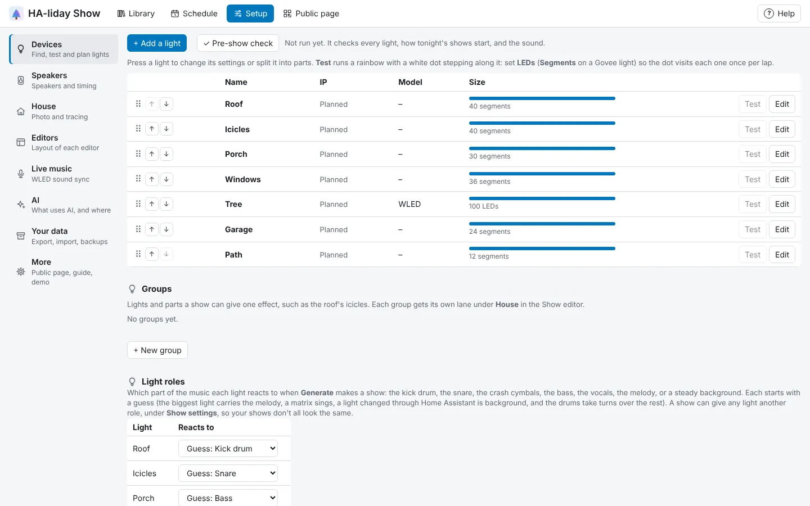
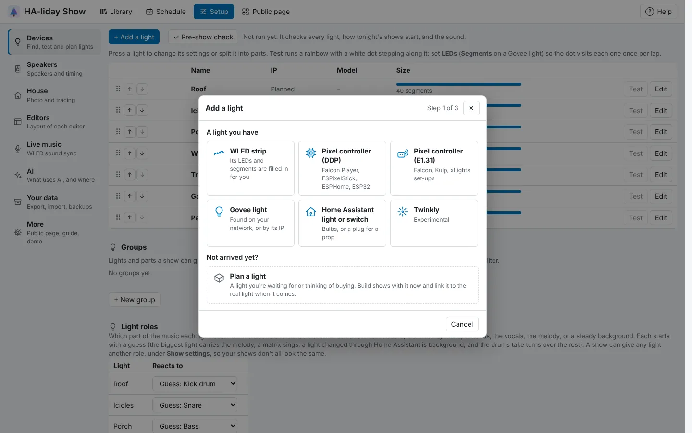

<!-- The user guide is written here, a page per topic. tools/check_guide.py checks its links. -->

# Adding your lights

Add each of your lights, whatever kind it is, and check it works.

On the **Devices** tab press **+ Add a light**. First pick what you're adding under **A light you have**
(a WLED strip, a pixel controller, a Govee light, a Home Assistant light or switch, or a Twinkly), or
**Plan a light** for one that hasn't arrived yet. Then fill in what that kind needs and press **Add**. For a
WLED strip or a Govee light, press **Scan network** and **Add** each light it finds, or type its IP if it
doesn't show up. When it's added, press **Add another**
for the next one, or **Done**.

The list shows one line per light: its name, IP, model and its **Size**, a bar with each part in its
colour and how many LEDs (or segments, on a Govee light) and parts it has. A Govee light
with a segment for every bulb, such as one on **Per bulb**, says bulbs instead. Press **Test** on a line to test the light. Press anywhere
else on the line (or **Edit**) to open the light's window, which has all its settings and its parts.
**Remove light** is at the bottom of that window. The settings are:

| Setting | What it does |
| --- | --- |
| Name | How the light is labelled in the editor and on the House tab. |
| LEDs | WLED, Twinkly and pixel controllers: how many LEDs it has, filled in or typed when you add it. |
| Segments | Govee only: how many separately controllable sections it has. Govee doesn't report it, so set it with **Find** or **Test** (see [Govee lights](#govee-lights)); most Govee strips and outdoor lights have 10 to 15. |
| Bulbs | Govee only: the real number of bulbs, so the House view draws each one. Leave blank to draw 4 per segment. On other lights the House view draws one bulb per LED. |
| Brightness % | Caps the light in every show, handy when one string is much brighter than the rest. It applies straight away, to previews too, without re-saving shows. |
| Reverse | Turn it on if effects run from the wrong end. |
| Blend | Govee only: asks the light to blend smoothly between neighbouring segments. |
| Protocol | Govee only: how colours are sent (see [Govee lights](#govee-lights)). Other kinds show how they're driven, such as **DDP** or **E1.31**. |

A Home Assistant light has neither **LEDs** nor **Segments**: it shows one colour at a time.

**Check segments**, at the bottom of a light's window beside **Test**, sends a white bar slowly from the
light's first bulb (or LED, or segment) to its last, over a dark light, for a minute. Watch it
go: a stretch it skips isn't lighting, and a bar that starts at the far end means **Reverse** is the wrong
way round.

## WLED strips

WLED strips work like any other light. Press **+ Add a light**, pick **WLED strip** and press
**Scan network** to find it, or type its IP address (it's on the WLED app's **Info** page) and press **Add**. HA-liday Show asks the
strip for its name and number of LEDs, so there's nothing to work out: its **LEDs** are filled in,
up to 1000 a strip. **Find**, **Blend** and **Protocol** don't apply to WLED, so they're not shown.

WLED has its own way of splitting a strip, **segments** in the WLED app. If you've set some up, they
become the strip's **parts** here when you add it, with their names (see *Splitting a light into
parts* below). Change them in WLED later? Press **Use WLED segments** under the strip to bring them in
again: a part keeps its clips as long as its WLED segment is still there. You can also split the strip
here by hand, without touching WLED.

### One WLED driving several strings

One WLED controller can run several strings, one on each of its outputs, such as a Gledopto with your
pillars on one pin and the left and right window icicles on the others. Set up a **segment** in WLED for
each string, then add the WLED: HA-liday Show asks whether you want **One light with parts** or **A light
per segment**. Pick **A light per segment** and each string becomes its own light, named after its
segment and starting at its first LED. Each one can be split into its own **parts**, traced on the house
photo and put in groups like any other light, and each can play **WLED's own effects** in scenes (on just
its segment).

The light's window shows its **first LED** on the WLED. Moved or resized a segment in WLED? Press
**Update from WLED** in the light's window. Added a segment in WLED later? Add the WLED again
(**+ Add a light → WLED strip**, or **Scan network** and **Add other segments**): only the segments that
aren't lights yet are added.

Already have shows for a light that's now one of those strings? Link that light first, then add the
WLED to bring in the other strings. The light keeps its shows, parts and place on the photo:
- a planned WLED light: type the WLED's IP into its window, and pick its segment when asked
- a WLED light that's already linked to the whole WLED: press **Just one segment…** in its window
- a Govee light you've rewired to the WLED: use **Convert to WLED…** (see below) and pick its segment

During a show HA-liday Show sets every LED itself, so the effect you picked in WLED, and its segments'
own effects, are paused until a couple of seconds after the show stops, then WLED carries on where it
left off. WLED's own brightness still applies, on top of **Brightness %** here. If only part of the
strip lights up during a show, open WLED's **Config → Sync Interfaces** and untick **Use main segment
only**.

To plan a WLED strip before it arrives, pick **Plan a light**, choose **WLED strip** as the **Kind of
light** and set **LEDs** to how many it has.

## Matrices (panels and mega-trees)

A WLED light, pixel controller or E1.31 controller can be a **matrix**: a grid of LEDs, like a 16 × 16
panel in a window or a mega-tree whose strings run side by side. A matrix can have up to 4,096 LEDs
(64 × 64), where a strip stops at 1,000.

A WLED set up as 2D (**Config → 2D Configuration** in WLED) is added as a matrix straight away. For
anything else, open the light (**Setup → Devices**, press it) and turn on **Laid out as a grid** under
**Matrix**, then set:

- How many LEDs **across** and **down**. Its **LEDs** are always width times height.
- **Starts at**: the corner the first LED is in.
- **Wired in**: whether the wiring runs along **Rows** or up and down **Columns**, and **Zig-zag** if
  each one runs back the other way, as most panels are wired.

A WLED set up as 2D sorts out its own wiring, so leave it as plain rows from the top left. **Read from
WLED** fills in the size from WLED again. On a pixel controller, set the wiring to match how it's wired.

Press **Test wiring** to check: the top-left LED lights white, the rest of the top row red and the rest
of the left column green. If they land anywhere else, change **Starts at**, **Wired in** or **Zig-zag**
until they don't.

**Reverse** isn't needed on a matrix. Put it on the house photo as a **Panel** or a **Mega-tree** (see
*Light styles*), and pick how each effect plays on it with **Runs** (see *Editing a clip*).

To give part of a matrix its own lane, such as a star in one corner or each window of a panel, drag
across the grid under **Parts** in its window. Each rectangle you drag out becomes a part: name it in
the list under the grid. Parts can't overlap. On the timeline, each part gets its own lane under the
matrix: effects made for matrices fill its rectangle, and other effects follow its **Runs** inside it.
With **Also play as one** ticked, the matrix keeps its own lane, playing across the whole grid; the
LEDs outside every part follow it, and so does a part while none of its own clips is playing.
Untick it if you only use the parts: the LEDs outside them then stay off. **Test** lights one part
on the real matrix, white at its top left, and **Test parts** lights them all in their colours.
Remove a part with **✕**; its clips stay in your shows. Making the grid smaller removes any part that no
longer fits, and turning **Laid out as a grid** off removes them all (it asks first); their clips stay in
your shows.

For a mega-tree, set the matrix up with one column per string: **across** is how many strings it has,
and **down** how many LEDs each string has. The top row is the top of the tree.

## Shaped props (stars, wreaths, spinners)

A WLED light, pixel controller or E1.31 controller can be a **shaped prop**: a star, a wreath, a
spinner, a candy cane, a window frame, or a vendor's coroplast prop such as a snowflake. Effects then
know where each LED sits in the shape, rather than treating it as a line. A shaped prop can have up to
4,096 LEDs.

Open the light (**Setup → Devices**, press it) and pick its **Shape**:

- **Star**: how many **Points**, and **LEDs per point** (the LEDs run round the outline from the top
  point, clockwise).
- **Circle or wreath**: how many **Rings**, and **LEDs per ring** (outer ring first, each from the top,
  clockwise).
- **Spinner**: how many **Arms**, and **LEDs per arm** (each arm from the middle outwards, the first
  pointing up).
- **Candy cane**: how many **LEDs** (up the stick from the bottom, then round the hook).
- **Window frame**: **LEDs across** the top and bottom, and **LEDs down each side** (from the top left,
  clockwise).
- **xLights model (.xmodel)…**: pick the prop's model file, as vendors publish them for xLights. HA-liday
  Show reads its pixel map and keeps its submodels as the prop's **bits** (listed under the picture).
  Only xLights *custom* models have a pixel map; for a star or wreath model, pick the built-in shape
  instead. **Import another…** swaps it for a different file.

Its **LEDs** follow the shape. The picture shows each LED where it sits: LED 1 is white and the colours
run red, yellow, green, blue along the wire from there. Press **Test wiring** to light the real prop the
same way. If LED 1 or the order doesn't match the picture, change the numbers (or the shape) until it
does.

### Bits

**Bits** are named sets of a prop's LEDs, such as a star's points, a spinner's arms or a snowflake's
middle. Each bit gets a lane of its own under the prop in the Show editor, so you can give it its own
effect. An xLights model's submodels come in as bits when you import it. To make one by hand, press
**+ New bit** under the picture, then press LEDs on the picture to add them (they turn white); press one
again to take it out. Press **Done picking** when it's right, and type a name for it. **Pick LEDs**
changes a bit later, and **✕** removes it (its clips stay in your shows).

Unlike parts, bits can share LEDs and can be scattered anywhere in the prop. Where two bits share an LED
and both have an effect playing, the one whose clip started last shows. LEDs in no bit, and bits with
nothing playing, follow the prop's own lane. Effects on a bit's lane are laid out as the bit sits in the
prop, so **Round the shape** and **Out from the middle** work on a bit too. **Generate** and the AI give
bits looks of their own, as they do parts. A shared show carries each bit's lane by name, and suggests
your prop of the same shape when it's imported.

### Singing faces on props

A face prop (a singing snowman, a Santa or a pumpkin made of pixels) can sing along. Its xLights model
usually brings the face with it: importing it sets up the mouth shapes and eyes from the model's face
settings, each as a bit. To set one up by hand, make a bit for each mouth shape the prop has and one for
its eyes (see *Bits* above), then open **Singing face** under the bits and pick the bit for each **Mouth**
shape (closed, A and I, O, E and so on) and tick the **Eyes**. A prop needs only a few: a closed mouth and
one open one will do.

Then add **Prop's singing face** to the prop's own lane in the Show editor. The mouth follows the singer,
and the words themselves once you've added the song's lyrics (see
[Lyrics for a Singing face](effects.md#lyrics-for-a-singing-face)). Any of the prop's LEDs that aren't a
mouth or the eyes are its outline, lit all the time.

Put it on the house photo with the **Its shape** style (see [Your house](house.md)), and pick how each
effect plays on it with **Runs** (see [The Show editor](show-editor.md)). Choose **None: a line of
lights** to turn it back into a plain strip; its clips stay in your shows.

## Moving a Govee light to WLED

Rewired a Govee light to run from a WLED controller? You don't need to add it again. Open
**Setup → Devices**, press **Edit** on the Govee light, then **Convert to WLED…** at the bottom of the
window. Type the WLED's IP address, or press **Scan network** and **Use** next to it, then press
**Convert**. If the WLED has several segments, you're asked whether the light is **The whole WLED** or
one of its segments (see *One WLED driving several strings* above).

Controller not plugged in yet? Leave the IP blank, set **LEDs** to how many it will have (it starts
at the light's **Bulbs**) and press **Convert**. The light becomes a planned WLED light, so you can
work on its shows straight away. Once the controller is on, type its IP into the light's window and
press **Test**.

- The light keeps its name, its tracks in every show and its place on the house photo.
- **LEDs** is set to the WLED's number of LEDs, and its parts keep their share of the light: on a
  44-segment light split into thirds, **Left**, **Center** and **Right** become thirds of the new length.
- Shows that use the light are updated straight away, so playlists, schedules and Home Assistant play
  them on every LED.
- **Reverse** stays as it was. Press **Test** afterwards, and if the white dot runs the wrong way,
  change **Reverse**.

## Pixel controllers

Strings on a pixel controller work too: Falcon Player, ESPixelStick, ESPHome, Tasmota, a home-made ESP32,
or anything else that listens for **DDP**. Turn DDP on in the controller's settings if it has a switch for
it. Then press **+ Add a light**, pick **Pixel controller (DDP)**, type the controller's IP and how many
**LEDs** the string has, and press **Add**. Controllers don't say how many LEDs they have, so check
with **Test**: the white dot should reach the end of the string.

One controller often drives several strings or props. Add the same IP again for each one: the new light
starts just after the last light on that controller. **first LED**, in the light's window, is where the
light starts in the controller's LED order, so you can set it to match how you've wired things. If two
lights on one controller share LEDs, their line says *Shares LEDs with…*. You can also add the whole
controller as one long light and split it into **parts** instead.

To plan one before it arrives, pick **Plan a light**, choose **Pixel controller (DDP)** as the **Kind
of light** and set **LEDs** to how many are on the string.

## E1.31 controllers

Most Falcon and Kulp controllers, and anything set up for xLights, speak **E1.31** (also called sACN).
Press **+ Add a light**, pick **Pixel controller (E1.31)**, type the controller's IP and how many **LEDs**
the string has, and press **Add**. Set the controller to take E1.31 as **unicast** (straight to
its IP); HA-liday Show doesn't use multicast.

Each light has a **universe** and **channel** in the **Model** column: where it starts in the
controller's set-up. Each LED takes 3 channels, a universe holds 510 (170 LEDs), and a light carries on
into the next universe when it runs past the end of one, the way xLights numbers them. Add the same IP
again for the next string and it starts just after the last one. Lights on one controller can share a
universe without blanking each other, and their line says *Shares LEDs with…* if two overlap.

When a show or test stops, HA-liday Show tells the controller, so it goes straight back to what it was
doing. To plan one before it arrives, pick **Plan a light** and choose **Pixel controller (E1.31)** as the
**Kind of light**.

## Govee lights

Switch on **LAN Control** for each light in the Govee Home app first. Then press **+ Add a light**, pick
**Govee light**, press **Scan network** and **Add** each light it finds, or type its IP if it doesn't show
up. Govee lights need a little more setting up than the others, because Govee doesn't report how many
segments a light has, and different models take colours in different ways.

### Setting the segment count

Press **Test**: a rainbow runs along the light with a white dot
stepping from segment to segment. Set **Segments** so the dot visits every segment once per lap,
and turn on **Reverse** if it runs the wrong way. If the light is still on its reel, press **Find**
next to **Segments** instead: a window opens, lights one segment and asks whether anything is lit.
Each answer halves the possible range, so after about 7 answers the count is filled in and the
window says what it found. **Cancel** stops it and lets the light go back to normal. Set **Reverse** later,
once the light is hung up.

While the test is running you can change **Segments**, **Reverse** or **Protocol** and the light
picks up the change straight away, so you don't need to press **Test** again after each one.

### Test only turns the light on?

Not every Govee light has a realtime mode. Change **Protocol** and press **Test** again:

| Protocol | When to use it |
| --- | --- |
| Realtime | The default, the same packets OpenRGB sends. Works for most strips and outdoor lights. |
| Whole light (one colour) | For lights with no realtime mode, or whose realtime mode only reaches part of the light. The whole light shows the average colour of its segments, at up to 10 changes a second, and each change fades a little. |

## Home Assistant lights and switches

Any light or switch in Home Assistant can join in: Zigbee and Hue bulbs, LIFX, or a smart plug driving an
inflatable or a lit-up prop. Press **+ Add a light** and pick **Home Assistant light or switch**. Type part of a
name in **Find a light or switch** (or pick **Colour lights**, **Other lights** or **Switches** to narrow the
list), press each one you want so it's ticked, then press **Add**: you can add several at once. A
double-click adds just that one, and so does **Enter** when only one matches. Ones you've already added
are greyed out. To swap one for another later, pick it in the light's window.

Changes go through Home Assistant, so these are slow, and each is one colour at a time:

- A **light** takes the show's colour up to 4 times a second. Fades, colour changes and pulses look
  good; chases and sparkles don't show on a single colour. A light that only does white gets just the
  brightness.
- A **switch** turns on while the show is at least half bright there and off when it's darker, whatever
  the colour. It changes at most once a second, to spare the plug's relay and the prop, so it suits
  beats in slower songs and changes between sections. **Brightness %** doesn't apply to a switch, as a
  plug can't dim. In the editor a switch shows as plain white when it's on and dark when it's off, and a
  clip is marked if it would leave the switch off the whole time, or keep it on so its colours are lost.
  A steady clip, such as **Solid**, is the way to have the prop on for part of the song.

Effects that are too fast for one are marked on the timeline, as for other slow lights. All your Home
Assistant lights and switches share about 10 changes a second between them, as that's what a Hue bridge
or a Zigbee network keeps up with, so with lots of them each one changes a little less often and none
fall behind. Just before a show or test starts, HA-liday Show remembers how each light and switch was, and
puts it back when it ends.

Running HA-liday Show without Home Assistant? These need `HA_URL` and `HA_TOKEN` set (see **Running
without Home Assistant**). To plan one, pick **Plan a light** and choose **Home Assistant light or switch** as the **Kind of light**.

## Twinkly lights (experimental)

Press **+ Add a light**, pick **Twinkly** and type the light's IP (it's in the Twinkly app under the
light's **Device settings**). Its name and number of LEDs are filled in for you, and you can
split it into **parts** like any other light.

During a show HA-liday Show switches the light into Twinkly's realtime mode and sets every LED itself; when
the show or a test ends, the light goes back to what it was playing. Twinkly doesn't officially support
this mode, and it hasn't been tried on a real Twinkly yet, so press **Test** first: a rainbow with a
white dot should run along the whole light. If nothing happens, or the colours are wrong, say so on
GitHub.

## Putting lights in order

Drag a light by its ⠿ handle, or use its ↑ and ↓ buttons. Every
show's timeline, the editor's preview and the House tab list lights in this order, with a split
light's parts kept together under it.

## Lights not delivered yet?

Press **+ Add a light** and pick **Plan a light**. Choose the **Kind of light** (a WLED strip to start
with, a pixel controller, a Govee light, a Home Assistant light or switch, or a Twinkly), give it a name
and press **Add planned light**, then build shows with it straight away. Each kind only asks for what it
needs: the strips, pixel controllers and Twinkly their **LEDs**, a Govee light its **Model** (for example
`H706A`, optional) and **Segments**, and a Home Assistant light just a name. For Govee models, a badge next to the model flags anything we've
found on real lights that you should know: **⚠ limited** (tested, only partly works; point at the badge
to see what it can do) or **? untested** (not tried with HA-liday Show yet: most
Govee lights with LAN Control work, so add one and press **Test** before buying more; the badge's
tooltip says whether Govee lists the model as having LAN Control). A model with no badge has been tested
and works on Realtime. A tested model
starts with the settings that suit it, such as 44 segments for the 30 m Christmas String Lights 2
(as many as it lights in realtime), both when you plan it and when you add it from **Scan network** (under **+ Add a light → Govee light**). Lights you've already
added keep their settings. Otherwise 15 segments is a guess until you test the real
light. Planned lights appear in the previews but nothing is sent to them. When the light arrives, type
its IP into the planned light's window (or pick it, for a Home Assistant light). For a Govee light you can
also press **+ Add a light → Govee light → Scan network** and choose **Link to** next to it. Its shows carry over, and if the real segment count differs, just change it: effects scale
to any number of segments.

<!-- nav: made by tools/check_guide.py -->

---

← [Getting started](getting-started.md) · [Contents](README.md) · [Parts, groups, roles and seasons](organising-lights.md) →
<!-- /nav -->
