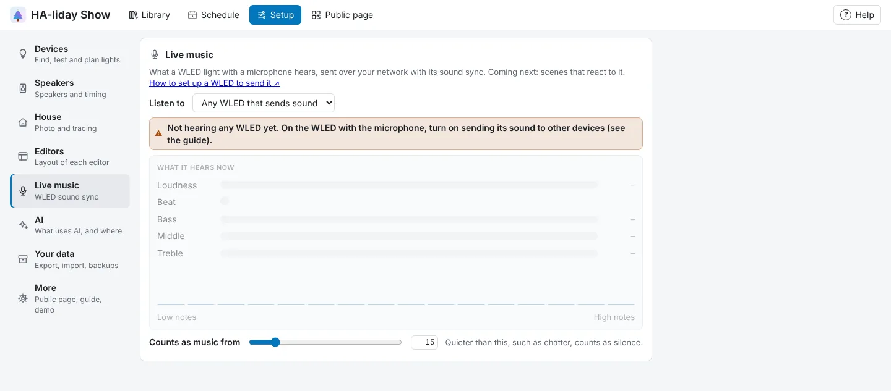

<!-- The user guide is written here, a page per topic. tools/check_guide.py checks its links. -->

# Live music

Lights that react to music playing in the room.

**Setup → Live music** shows what a WLED light with a microphone hears: how loud it is, each
beat, and the bass, middle and treble. A scene with **React to music** switched on follows it (see
[React to music](#react-to-music) below).

A WLED hears music with a small microphone wired to its controller (an INMP441, say, on an ESP32 board),
with the **AudioReactive** usermod that most ESP32 builds of WLED 0.14 and later include. It doesn't
need to be one of your show lights: a small board by the speaker works well. To have it send what it
hears:

1. In that WLED's web page, open **Config → Usermods** (on some versions it's under **Config → Sync
   Interfaces**) and find **AudioReactive**.
2. Check the microphone is set up and the WLED's own sound effects react to music.
3. Under its sync settings, set **Mode** to **Send**, and leave the port at **11988**.

Within a few seconds it appears under **Listen to**. With more than one WLED sending, pick one, or leave it
on **Any WLED that sends sound** to use the loudest. **Counts as music from** sets how loud counts as music,
so chatter in the garden doesn't. A ⚠ note says if nothing is heard, or if a WLED sends in an older
format (update it to 0.14 or later).

It works on your home network only, and needs nothing from Home Assistant. If HA-liday Show can't listen
on UDP port 11988 (another program on the machine has it), the card says so. With Docker, keep the host
networking from `docker-compose.yml`, or the sound won't reach it; with pipx, let UDP port 11988 in
through your computer's firewall.

## React to music

Any scene can follow the music. Open it, and under **Music** switch on **React to music** (for an Advanced
scene, press **React to music…** in the bar above the timeline). Then:

- **When it's quiet, down to** sets how dim the scene gets in the quiet parts. The louder the music, the
  brighter the scene, up to its normal brightness.
- **Flash on each beat** lifts every light towards white on every beat, the dark gaps too, dying away
  over a quarter of a second. **Flash strength** sets how far.
- **Strong bass plays** and **Strong treble plays** pick another of your scenes to switch to while the bass
  (or the treble) is loud and well above the other. It stays at least a second, so it doesn't flicker.
  Leave them on **None** to stay on this scene. Changes to those scenes show the next time this one
  starts.
- **Back to normal after** sets how many quiet seconds it waits, with the music stopped or no WLED heard,
  before gliding back to the plain scene at its normal brightness.

The card says whether a WLED is sending sound now. Which WLED it listens to, and how loud counts as
music, are set on the **Live music** card. A reacting scene plays like any other: from **▶ Play**, the
schedule, a playlist, Home Assistant's scene list, and after a show. **Scenes' brightness** (the
HA-liday Show light in Home Assistant) still sets how bright it is at its loudest. Your lights' limits
are the same as for shows.

## Live music effects

A light in a scene can also play an effect that follows the music itself. Pick one from the **Live
music** group in its effect window: on a light's row in a Basic scene (a light not split into parts),
or on a light's lane in an Advanced scene, where, like **WLED's own effect**, it covers the whole loop as
the lane's only effect.

- **Level meter** fills the light with the level: **from the start**, **from the middle** or **from both
  ends** (pick under **Fills**), in its colours from the first to the last (a palette fills them).
- **Beat burst** plays a short burst on every beat the WLED hears: a **ripple** out from the middle, a
  **shockwave** along from the start, a **sparkle**, or a **flash** of the whole light. **Length** (in
  the Speed column of its row) sets how long each burst lasts, 0.2 to 2 seconds; between beats the
  light is dark. The level it follows
  sets how bright each burst is, never quite off.
- **Spectrum bars** shows the music from bass to treble: a bar for each part of the sound, side by side
  along a strip (each section filling along it) or up a matrix's columns (each rising from the bottom),
  up to 16 bars. It always shows every part of the sound, so it has no **Follows**.

**Follows** picks what it follows: **loudness**, **bass**, **mid** or **treble**. Give one light the bass
and another the treble, and they move to different parts of the music. With no music for a few seconds
(or no WLED heard), a live effect breathes gently in its colours instead, so the house never looks off.

While you edit, the preview follows what your WLED hears; with nothing sending, it follows a made-up
song so you can see it move. If **React to music** is on too, its brightness and beat flash work on top
(its strong bass and treble scenes don't change a light on a live effect). The idle glow breathes every
4 seconds, so in an Advanced scene keep **Goes round every** to a multiple of 4 seconds for a smooth loop.

<!-- nav: made by tools/check_guide.py -->

---

← [Scenes](scenes.md) · [Contents](README.md) · [Schedule](schedule.md) →
<!-- /nav -->
