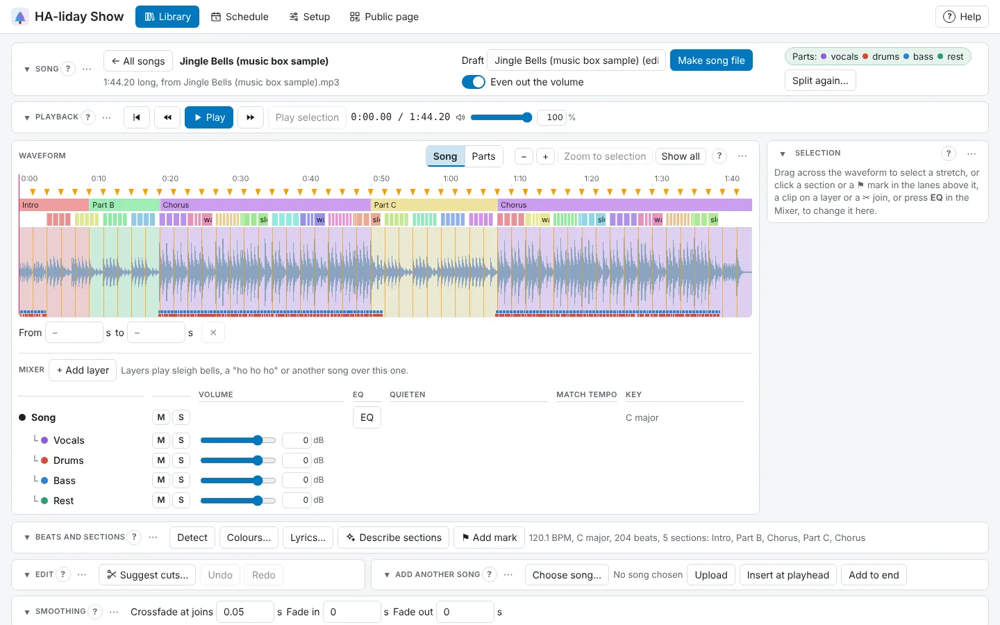

<!-- The user guide is written here, a page per topic. tools/check_guide.py checks its links. -->

# The Music editor

Cut, shorten and join songs, layer sounds over them, mix them and make mashups.

## Editing a song

The **Music editor** cuts, shortens and splices songs before you build a show. Press **Edit** on a
song under **Library → Songs** (with **+ Add a song**) to open it; nothing is touched until you do. The open
song's name sits beside **← All songs**, which goes back to the list to open another. The song you open is never changed: your
first change starts a [draft](#drafts), kept as you go, which you make into a new song file when you're
happy. Drag across the waveform to select (clicking moves the playhead and keeps the selection; press **✕**
next to its times or Esc to clear it). The **Selection** panel then says what you've selected (the
section's name when it's exactly one section, its times, and how long in seconds and bars) with what you
can do to it: **▶ Play selection**, **Preview cut**, **Cut** to remove it, **Keep only this** to shorten
the song to it, **Repeat ×2** or **Repeat ×4** to play it twice or four times in a row (what comes after
moves on; select whole bars for a seamless loop), and **Save as sample…**. Or let **✂ Suggest cuts…** (in the **Edit** panel, with
**Undo** and **Redo**) find the cuts for you (see
[Suggest cuts](#suggest-cuts)). To splice in another song, press **Choose song…** under **Add another song**: it
opens your songs in their folders, as in **Library → Songs**, or type in the box to find one in any
folder. Pick it and press **Choose** (or double-click it), or **Upload** a new one. A song that's been
split into parts lets you splice in just one part, under **Use from**. Then **Insert at
playhead** or **Add to end** adds it, and it's selected so you can trim it. Joins blend over the **Crossfade at joins**
time (a few hundredths of a second hides the click, a few seconds blends one song into the next), and
**Fade in** and **Fade out** soften the ends. Zoom with the wheel, or type the selection's times for
precision. **⏮** goes back to the start, and **⏪** and **⏩** go back or on a bar (5 seconds before the song
is detected), carrying on playing if it was. The 🔊 slider by the clock sets how loud it plays in your browser. Once the song is detected, selection edges snap to bars
(hold Shift to place them freely), clicking a section in the lane selects exactly its stretch (Shift-click
adds the next), and **Preview cut** plays the join before you cut, with the playhead jumping over the selection as the cut would. Beats and sections follow your edits
and are kept when you make the song file. Zoomed in, edges also snap to beats, and to the kicks and snares
of a song that's been split into parts. Edit the song before placing clips, because cutting it
afterwards won't move them.

Each join shows as a dashed line with a **✂** at the top. Click the **✂** to hear a few seconds either
side of the join; the **Selection** panel says what was cut there (how much, and from where in the
song). To change that cut, press **Adjust cut**: the part comes back and is selected, so drag its edges
(or type the times) and press **Cut** again. **Put back** undoes just that cut, leaving the
others as they are. Both are one step for **Undo**. A join where another song was spliced in only has
**▶ Hear join** and **Transition**. **Transition** gives any join a DJ-style change into what comes next:
**Echo out** (the last beat before the join repeats, fading, over the next part), **Filter sweep** (the
highs sweep away over the bar before the join, as if the music's going under water) or **Drop the bass**
(no bass for the bar before the join, then it all comes back at once). They keep time with the music
before the join, and you hear the join as soon as you pick one. **None** puts it back to a plain join.
When you zoom out, the beat lines thin out to every bar, then every 2nd or 4th bar, so
the music stays visible; zoom in to see every beat.

You can also use the keyboard: press Tab until the waveform is outlined, then **←** and **→** move the
playhead a beat at a time (a second at a time before **Detect**), and holding Shift selects as you go.
Space plays, Home goes back to the start, , and . go back or on a bar, Delete cuts the selection, M adds a
[mark](#marks), Ctrl+Z undoes and Ctrl+S makes the song file.

## Drafts

An edit is kept as a **draft**: a note of which parts of which songs it uses, with its crossfade and
fades, but no audio of its own. Your first change to a song (a cut, a splice, a crossfade or a fade)
starts one, named after the song, such as "sample-song (edit)"; type a better name under **Draft** at
the top. **Draft kept** beside it says it's saved, which happens a moment after every change, so you
can close the page or carry on from another device. If a change can't be kept (HA-liday Show stopped,
say), the status bar says so, even for a draft you've moved on from, and it's tried again with your
next change; closing the page then asks first. A song can have several drafts, such as a "Short
version" and a "Party mix": press **Edit** on the song again to start another.

**Library → Songs** lists each song's drafts inside its card (see [Songs](songs.md)): as **✎ Draft · no
file yet** until a song file has been made from it, then with that file as **✂ Edit · song file**.
**Edit** (or **Edit draft**) carries on where you left off (**Undo** starts afresh each visit),
**Rename…** renames it, and **Delete…** deletes the draft (not the song, or any file it made).

**Make song file** (Ctrl+S) writes the draft as a WAV in `/media/haliday_show/`, named after the draft,
so every speaker can play it; pick it under **Song** in a show. Its beats, sections and marks go with it,
and so does the cover art of the song you started from.
The draft stays open, so you can keep changing it. Making it again asks whether to **Replace it** (the
same file, so shows and playlists using it get the new version; the window lists those shows, since
their effects don't move with the music, and any other drafts that splice that file in, which will play
the new version too) or **Make a new file** (such as "Short version 2.wav"). Making a
song file without changing anything is a quick way to get a WAV copy of a song.

**Even out the volume**, beside **Make song file** and on unless you turn it off, turns the new file up
or down so it plays at about the same loudness as other songs made here, the level most streaming
services play at. That way one song doesn't blast out after a quiet one in a playlist. Only the overall
level changes, and a song is never turned up so far that its loudest moments would distort, so a very
spiky one may stay a little quieter. The status bar says how much it was turned up or down. The switch
is remembered in this browser.

Songs you edited before drafts existed are ordinary songs: press **Edit** on one to start a draft from
it. A draft can't be opened if a song it uses has been archived or deleted; restore the song first
(under **Archived songs**). Until then, drafts whose song has gone are listed together at the end of
**Library → Songs**, under **Drafts of songs that aren't here any more**, so you can still delete them.

## Layers

Layers play samples or other songs on top of the song: sleigh bells over the intro, a "ho ho ho" on the
last chorus, a voice saying "Merry Christmas", or another song fading in under the end.

1. Under the waveform, in the **Mixer**, press **+ Add layer** (up to four). Its row has its name,
   **M** and **S** (mute and solo), **Volume**, **EQ** (see [Mixer](#mixer-bass-mid-treble-filter-tempo-and-key)),
   **Quieten**, **Match tempo**, **Key** and **⋯**, and a lane appears under the waveform for its
   clips. Double-click the name (or use **⋯ → Rename**) to rename it; **⋯ → Remove** removes it.
2. Put the playhead where you want a clip to start, then press **⋯ → + Add a clip at the playhead…** on the layer's row. A
   window opens with your **Samples** and **Songs** in their folders (type in the box to find one in any
   folder). Pick one and press **Add**. A song that's been split into parts also offers **Use from**:
   **The whole song**, or just one part, such as **Just the vocals**. The clip starts a little quieter
   than the song, so it sits in the mix; change that with the clip's **Volume**. A clip of one part is
   labelled with it in the part's colour, such as **Vocals · Carol** in purple.
3. Drag a clip to move it (it snaps to bars, beats and marks; hold Shift to place it freely). Drag its
   left or right end to trim it. Click a clip to pick it (the playhead goes where you clicked): its panel
   has **Volume**, **Fade in**, **Fade out**, **▶ Hear it**, **✂ Split at playhead** (or press S) and
   **Delete** (or press Delete). Each clip shows its own waveform and, once its song has been detected,
   its sections in their colours, so you can see where its chorus or drop is. To use just parts of a
   song on a layer, split it where each part starts and ends, delete what you don't want and drag the
   rest where it goes.
4. To make a layer stand out, such as a voice saying "Merry Christmas", turn on **Quieten** on its row,
   with **the song** picked beside it. The song dips while that layer's clips play (starting just before each one) and comes back up
   gently after. **By**, beside it, sets how far: from a little (3 dB, so the song is still clearly
   heard) to nearly silent (24 dB); it starts at 8 dB. Where two layers that quieten the song play at
   once, the song dips by the bigger amount. It's off for new layers.

   Or the other way round: pick **this layer** and the layer goes down while the song sings, and back up
   between lines, so a horn or a choir doesn't fight the singer. It follows the song's vocals as you hear
   them (none where you've muted them), so the song needs splitting into parts first. **By** sets how far
   here too.

**Editing a layer on its own.** Click a layer's name at the left of its lane (or **⋯ → ✎ Edit this
layer** in the Mixer) and the big waveform shows that layer instead of the song: its own sound, in the
layer's colour, with the song faintly behind so you can see where you are, and its clips' songs' beats
and sections where its clips play them (a clip of a song's vocals shows that song's sections). A blue bar
says **Editing layer Choir**, its lane is outlined and its Mixer row says **Editing**. Now:

- Drag across the waveform, or click a section, to select a stretch of the layer. Selections snap to its
  own bars and beats, and to the kicks and snares of its clips' songs.
- **Cut** asks **Cut and close up** (the rest of the layer moves earlier to fill the gap, crossfaded at
  the join) or **Cut and leave a gap** (the layer is silent there). Either way the song and the other
  layers don't move.
- **Preview cut** plays a few seconds either side of the join, closed up, with everything else as it is.
- **Keep only this** trims the layer to the selection, leaving the rest of it silent.
- **Repeat ×2** and **Repeat ×4** play that stretch of the layer twice or four times in a row; the rest of
  the layer moves on after it, and anything pushed past the song's end is left out.
- Under the selection, the layer's own group (**Choir here** for a layer called Choir) changes the layer's volume over just that stretch: **Mute here**,
  **Quieter here** (6 dB down), **Fade in here** or **Fade out here** (from silent to full, or the other
  way, across the selection). Each shows on the layer's lane, hatched or as a slope, and stays with that
  moment of the song if you cut the song afterwards. **As it was** (or **Muted here ✕**) takes them off the
  selection. A layer that quietens the song doesn't dip it where the layer's muted, and a muted vocals
  layer's words are left out of a song file made from it.
- **Add another song** goes into the layer: pick the song with **Choose song…** as usual, then **Insert
  into Choir at playhead** (the rest of the layer moves on by its length; a clip running across the
  playhead is split there) or **Add to end of Choir** (after its last clip). The song and the other layers
  don't move, and it's selected so you can trim it. Anything pushed past the song's end is left out (the
  message says so; Ctrl+Z brings it back).
- To change the sections of a clip's song, open that song in the Music editor: they're the song's own,
  used everywhere it is.

Press **← Back to the song** (or the layer's name again, or **Song** on another lane) to edit the song
again. Every change is one **Undo** step.

**Change a clip's part.** Click a clip of a song that's been split into parts, and **Use** in its panel
switches it between **The whole song** and just one part (**Just the vocals**, **Just the drums** and so
on), where it is, without adding it again.

**Cutting in the middle of a word.** With the song's lyrics placed, **Cut** checks whether either end of
the cut lands inside a sung word. If one does, it offers **Move it between words** (each end goes to the
nearer edge of its word) or **Cut here anyway**.

Each clip is pinned to the moment in the song it starts at, so it moves with your cuts: cut a bit
earlier in the song and it moves earlier with the music; cut the part it sits on and it's left out
(**Undo** or **Put back** brings it back). A new clip is trimmed to the song's end. One that runs past it (after a cut, say) stops there, and
its end sits at the song's end so you can drag it in.
If you delete a sample a draft uses, its clips show greyed out and silent until you delete them or add
the sample back. Layers are part of the draft and every change is one
**Undo** step. **Make song file** mixes the layers into the new file, keeping the mix from
distorting where they pile up. The waveform, **Detect** and **Suggest cuts** go by the song alone, and a
sample saved with **Save as sample…** includes the layers unless you pick one sound.

## Mashups

**✨ New mashup…** in **Library → Songs** puts one song's singing over another's music. Both need to be
[split into parts](songs.md#split-into-parts).

1. Pick **The singing from** (its vocals are used) and **The music from** (everything but its vocals):
   press **Change…** on either to pick from your folders. Each shows its tempo and key once it's been
   detected.
2. A box says how well they fit and what will change, such as "A good fit. The singing is sped up 3% to
   121 BPM, and moved up 2 semitones into A minor". **Great fit** and **Good fit** need little change; a
   **Big change** (more than about 10% faster or slower, or a key far away) can start to sound odd.
3. **Start the singing at** picks where in the music the singing comes in (one of its sections, or the
   start), and **From the singing's** where in the singing song it starts from.
4. **Match tempo**, **Match key** and **Line up on the bar** are on to start with: the singing plays at
   the music's tempo, in its key, with its bars on the music's bars.
5. Press **Make mashup**. The Music editor opens a draft of the music song with its own vocals muted
   (the Mixer's **Vocals** row) and the singing on a layer of its own, ready to play. Neither song is
   changed. Fine-tune it as you would any draft, then **Make song file**.

**Shows on a mashup.** When you make a song file from a mashup (a draft with layers, or with the song's
own parts changed), its words are the ones you hear: another song's lyrics where its vocals (or the whole
song) play on a layer, timed through the clip (its trims, and its tempo if it's matched), and none of the
song's own where its vocals are muted. Its drum hits come from the drums you hear too, layers and all.
So a **Singing face** in a show on it mouths the layered singer's words, and **Drum hits** flash on the
drums that are really there. To change a mashup's words, open **Lyrics…** in a show on it (they're its
own, not its songs'), or change the songs' lyrics and make the file again.

**Find a match.** In **⋯ → + Add a clip at the playhead…**, under **Songs**, **Sort: Best fit first**
(beside **By name**) puts the songs that would fit best over this one at the top, going by the tempo and
key **Detect** found. Each says how well: **Great fit**, **Good fit**, **Fits with a change** or **Big
change**, and why, such as "4 BPM faster · C major, fits A minor" (relative keys share their notes, so
need no change). Songs not detected yet come last.

**Add just a section.** Once you've picked a song, **Which part of it** lists its sections with their
times, such as **Chorus 0:48 – 1:12**: pick one to add just that stretch (it fades in and out a little),
or **All of it**. **Line up on the bar** (on to start with) lands its first bar on the song's nearest bar.

**Clips line up on the bar.** Wherever both songs have been detected, a clip you add or drag on a layer
lands with its first bar on the song's nearest bar, so the two stay in step. Hold **Alt** (or **Shift**)
while dragging to place it anywhere.

**Two songs' tempos and keys.** Click a clip of another song: its panel shows that song's tempo and key
beside this one's and what it'd take to fit, with **Match tempo and key** to set both on its layer in
one go.

## Mixer: bass, mid, treble, filter, tempo and key

The **Mixer** under the waveform works like a DJ's, for mash-ups and for making a layer sit well with
the song. The song has a row, and so does each layer, with their controls lined up in columns (on a
narrow screen, each row wraps and labels its controls).

- **The song's parts.** Once the song's been [split into parts](songs.md#split-into-parts), its row has four more
  under it: **Vocals**, **Drums**, **Bass** and **Rest**, each with **M**, **S** and **Volume**, like stems
  on a DJ controller. Mute its vocals for an instrumental, or turn the drums down. To change them over
  just a stretch, select it and use **The song's parts here** in the **Selection** panel: **Mute vocals
  here** (or drums, bass, rest), or **Vocals only here** for an a cappella bit. A part muted there shows
  as **Drums muted here ✕**: press it to bring them back. These are kept with the draft, follow your cuts,
  and go into the song file you make, and into its own parts (a muted part is quiet in that part too).
  **Parts**, beside the zoom buttons at the top of the waveform, shows the song as its four parts on rows
  of their own, in their colours, with where each is muted hatched; click a hatched stretch to select it.
  **Song** goes back to the song's waveform. If the song (or a song spliced into it) hasn't been split,
  the Mixer says so instead.
- **M** (mute) silences a row, and **S** (solo) lets you hear only the rows you've soloed, so you can
  hear a layer on its own or check how two fit together. They're also at the left of each lane on the
  waveform, beside its name, and a row you can't hear shows faded. It keeps playing while you press them.
  Solo, and muting the song, are only for listening: a song file made from the draft has everything in
  it. Muting a layer is kept with the draft and leaves it out of the song file, until you unmute it.

- **EQ** opens that row's **Bass**, **Mid** and **Treble** faders in the **Selection** panel (press it again,
  or **✕**, to close them; another row's **EQ** swaps to its faders). Each goes from +6 dB down to **off**
  at the bottom: take the bass out of the song while a layer's bass carries it, say, or the treble off a
  layer so it sits behind. The **EQ** button is highlighted when anything is changed.
- **Filter**, under the faders, is a DJ's filter: slide it left to muffle the sound, as if it's coming
  through a wall, or right to thin it out until only the top is left. The middle is off. Sweep it with
  changes (below) for a build-up: muffle the song, then open it up on the drop. A change made before you
  used the filter has it off, so the sound opens up again there; move the playhead past it to set it.
- **Changes partway through:** put the playhead where it should change, press **+ Change here**, then
  move the faders (and the **Filter**). From there the sound glides to the new settings over **Glide** seconds (1 by
  default; 0 for an instant switch). The faders always show, and change, the setting at the playhead:
  before the first change that's the row's own setting. A change shows as a small diamond: the song's
  along the bottom of the waveform, a layer's in its lane. Click one to put the playhead on it, drag it
  to move it, and press **Delete change** (or Delete) to remove it. Changes move with your cuts, like
  clips.
- **Match tempo** on a layer speeds up or slows down its clips to the song's tempo, keeping their pitch,
  so a loop or another song stays in time. The song needs **Detect** first, for its tempo. Each clip's
  own tempo is taken from its beats if it's been detected, or found when it's added (a clip needs a few
  seconds of steady beat). If it's wrong or missing, click the clip and type it under **Tempo**. A clip is
  never stretched more than about 1.4 times either way: one at half or double the song's tempo plays
  in time at about its own speed. Line the clip's first beat up with a bar (clips snap to them).
- **Key** on a layer moves its clips up or down so they're in the song's key and don't clash. **Match the
  song** works out the song's key (or uses the one **Detect** found, shown beside its tempo) and each
  clip's, and moves each clip by as few semitones as it takes (at most 6), keeping its speed. A key and
  its relative minor or major (C major and A minor, say) share their notes, so they count as the same. Or
  pick **+1** to **+6** or **−1** to **−6 semitones** to move it by hand; **Own key** leaves it as it is.
  A clip too short to tell (under a second) stays as it is. A big move (5 or 6 semitones) can sound a
  little artificial.

All of it is part of the draft, every change is one **Undo** step, and **Make song file** includes it.
The waveform still shows the song as it was, without the mixer, with two marks on top so you can see
what the mixer does:

- Where a layer quietens the song, a grey band hangs down from the top of the waveform: the deeper it
  goes, the more the song dips (all the way to the middle is 24 dB). It's labelled with how far, such as
  **Song −16 dB**.
- When the song has EQ, three thin lines run along the bottom of the waveform: orange for **Bass**, green
  for **Mid** and blue for **Treble**. A line above the others is turned up, below them turned down, and
  each glides into a change as the sound does. A purple line is the **Filter**: down for muffled, up for
  thin.

## Suggest cuts

**Suggest cuts** finds places to make the song, or one section of it, shorter without the join being
heard: for when the intro goes on too long, say, or the song is longer than your show needs. It works
in whole bars, so the song needs to be detected first (**Detect**).

1. Press **✂ Suggest cuts…** in the **Edit** panel, or pick a section in the lane and press **✂ Shorten…**.
   A window opens, set to the section you've picked (or **the whole song** if you haven't picked one).
2. Under **Shorten**, choose **the whole song** or a section. Under **To about**, type how long you'd
   like it, as 1:30 or 90. It starts at half the section, or three quarters of the song, and shows how
   long it is now.
3. Press **Find cuts →** (or Enter). You get up to three options.
4. Press a cut's **▶** to hear a few seconds either side of its join. What it would take out shows in
   red on the waveform.
5. Press **Use** on the one you like. The cut is made and the window closes. **Undo** in the **Edit**
   panel (or Ctrl+Z) takes it back. To try another length instead, press **← Back**.

It only takes out whole bars, in 4- or 8-bar phrases where it can, and only where the music either side
of the join matches, such as a loop that repeats or a verse and chorus that come round again. For the
whole song, an option can be several cuts, taken from parts that are heard again elsewhere, and it never
cuts off the ending (use **Fade out** for that). Each option says how many bars go, how much shorter it
makes things, and how well its join matches: **smooth join**, **good join** or **join may be heard**.
If nothing fits, it says so; try a length a little longer or shorter.

With an [AI set up](ai.md), it's also asked which option works best musically. The
options show straight away, so you can listen while it thinks. When it answers, the one it thinks
works best is marked **AI's pick** and each gets a short reason under it (such as "Drops the repeated
second verse; keeps the 1:12 crash"); they stay where they are, so nothing moves as you reach for
**Use**. It asks once each time you press **Find cuts →** (and only when there's more than one option),
which counts as one AI request. It goes by the song's name (it may know the song), your section names and notes
(the ones you wrote count most) and your [marks](#marks), so it steers away from cutting a moment you've
marked. It can't hear the song, so listen to the joins yourself. If it can't answer, the options are
still there, without its pick.

Nothing changes until you press **Use**, and the song you opened is never changed: a cut you use goes
into your [draft](#drafts), and **Make song file** turns it into a new song file.

## Marks

Marks flag moments in a song you want to light, such as a big hit, the bells coming in or the last
note. They're kept with the song, so every show that uses it gets them, and they don't change when you
**Detect** again.

- **Add one:** in the Music editor, put the playhead where you want it and press **⚑ Add mark** (in the
  **Beats and sections** panel), or press **M**. **M** works while the song plays, so you can tap
  it along with the music and name the marks afterwards. You don't need to **Detect** the song first.
- **Name, colour or delete it:** click its flag in the beat lane (the playhead jumps to it), and change it
  in the **Selection** panel. Type a
  **Name**, pick a **Colour**, or press **Delete**. **Move to playhead** moves it to where the playhead is,
  and **✕** or Esc closes it. Each new mark takes the colour you picked last.
- **Move it:** drag its flag. It snaps to beats and bars; hold Shift to place it freely.

In the **Show editor**, a song's marks show as coloured flags on the **Beats** lane, with a line down
through every light, and clips snap to them (when **Snap** is on) so you can line an effect up with
the moment. They're read from the song each time you open the Show editor, so marks you add in the
Music editor show straight away. To change them, go back to the Music editor.

Marks follow your cuts: a mark in a part you cut out disappears from the edit, and the rest move with
the music and go with the song file when you **Make song file**. You can add, change and move marks while you're
editing too. They're saved on the song you opened as well, at the same moment in it, and that song keeps
all its marks, even ones in parts you cut out of the edit. A song spliced in brings its own marks,
shown faintly with a dashed line; they go with the song file too, but you change them on that song
itself. The one place you can't add a mark until you've made the song file is a part spliced in.

## Detecting in the Music editor

**Detect** in the Music editor finds a song's beats, bars and sections and keeps them with the song file,
drawn over its waveform. A song file you make from a draft keeps the beats and sections that followed
your cuts. A song spliced in brings its own beats, sections (with their names and notes) and marks, so
nothing is lost. Only if a song in it hasn't been detected yet is the new file detected afresh (the
marks still go with it). When a show picks that song
under **Song**, it takes them automatically (asking first if the show already has beats), and **From
song** in the Beats panel brings them back later. Detect in the editor also saves its results with the
song. Each show keeps its own copy, so moving beats in one show doesn't change the song or other shows.

## Editing sections

In the Music editor, the lane above the waveform shows each section in its colour.
Click one to change it in the **Selection** panel: rename it or pick its colour (every section with the same name changes colour together),
**✂ Shorten…** it (see [Suggest cuts](#suggest-cuts)),
**Split at playhead**, **Merge with next** or **Delete** it, and drag the line between two sections to
move it. Changes save with the song; a show that already uses the song picks them up with **From song**.
Give a section **Notes** to tell **Describe it** what happens there or how you'd like it lit, such as
"bells only, very gentle" or "big drop at the end, everything flashes"; the AI follows them.

You don't have to write them all yourself. **Detect** writes notes for every section, and **✨ Describe
sections** writes them again for the sections as they are now (after you've split or moved them,
say). It listens to each section and notes how loud it is, whether it builds up or fades, whether it's
busy or sparse, bass-heavy or bright, any big hits or moments it goes quiet (with their times), and
which earlier section it's like. Once the song has been through **Split into parts** (and its words
lined up with **Lyrics**), the notes also say what can be heard in each section (a choir, sleigh bells,
brass), where the singing starts and stops, when the drums come in, any cymbal crashes and the line
being sung. It then suggests how to light it, for example: "Loud; you can hear a choir; singing from
0:26 to 0:44; drums come in at 0:24. Everything on, moving and flashing on the beat; slow washes for the
choir; bring everything in when the drums start; drop to a soft glow when the singing stops." Notes you've typed or changed are never replaced, and nor are names you've
given sections: pressing **Detect** again carries them over to the new section that covers the same
stretch of the song. Edit anything it writes; once you do, it's yours.

With an AI set up (see [Setting up the AI](ai.md)), or the [notes model on this
device](ai.md#section-notes-on-this-device), the AI then rewrites those notes,
usually within a minute, while you carry on. It can't hear the song, so it works from the same
measurements (including what can be heard, the singing, drums and words) and the song's name. If it knows the song, it uses what it knows: which part is the verse
or the chorus, where it builds. It also gives the sections Detect named itself better names, such as
**Part B** becoming **Verse**, but never a name you gave. If you edit the sections before it's done,
its notes aren't used, so press **✨ Describe sections** to ask again. Without an AI, or if it can't
answer, the simpler notes stay.

## Beats

Press **Detect** to have the editor listen to the song and find its tempo, every beat,
where each bar starts (drawn as stronger markers) and its sections, which show as tinted, named bands
behind the waveform (Intro, Verse, Chorus, Bridge, Outro). It runs in your browser in a few seconds,
with nothing sent anywhere. Detection reads songs as 4/4 and prefers a lively tempo, so a slow ballad
may come out at double time; type the BPM you want and press **Fill** if so. You can also press **B**
(or **Tap beat**) in time with the music while it plays, type a **BPM** and press **Fill** to add beats
from the playhead, or click the beat lane to add or remove one. **Clear** removes the beats and
sections. With **Snap** on, clips and selections snap to beats and to each other; hold Shift to
place freely.

<!-- nav: made by tools/check_guide.py -->

---

← [Songs and samples](songs.md) · [Contents](README.md) · [Pictures and faces](pictures-and-faces.md) →
<!-- /nav -->
