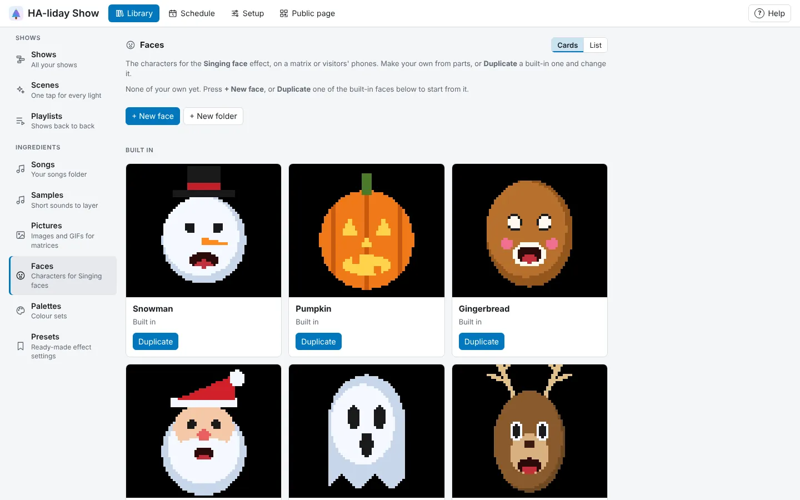

<!-- The user guide is written here, a page per topic. tools/check_guide.py checks its links. -->

# Pictures and faces

Pictures and GIFs for matrices and phones, and your own Singing faces.

## Pictures

**Library → Pictures** keeps pictures and animated GIFs for the **Picture** effect on a matrix (see
*Matrices* under *1. Devices*). Press **+ Add a picture** and pick one or more image files: PNG, JPEG,
GIF and the other kinds your browser can open. Each is shrunk to fit the biggest matrix (64 × 64) as
it's added, and a GIF keeps up to 120 of its frames, so small, bold pictures with few colours work
best. See-through parts show the effect's **Background**. You can keep up to 200 pictures, and a file
over 2000 × 2000 needs making smaller first.

A sharper copy (up to 256 × 256) is kept as well for visitors' phones, where a **Picture** on the
**Phones** lane is drawn four times finer than the rest of the screen, so it's smooth rather than blocky.
It's stored compressed so a phone downloads it quickly; a long GIF may keep only every other frame on
phones (each showing for twice as long). Pictures added before HA-liday Show 0.2.401 don't have one:
delete and add them again to get it.

Each picture's row shows its first frame, its size and, for a GIF, how many frames it has and how long
it takes, then **sharp on phones** when it has a phone copy. **Rename…** changes its name; **Delete…** (under **⋯**) removes it for good, and **Picture**
effects that used it show their background. Sort them with folders (see [Folders](shows.md#folders)).

## Faces

**Library → Faces** keeps the characters for the **Singing face** effect (on a matrix, or on visitors'
phones). The built-in ones are listed under **Built in**; yours are above them.

Press **+ New face** to open the face maker, or **Duplicate** on any face (built-in or yours) to start from
it. Pick each part from its list and give it a colour:

- **Head**: round, oval, wide, a Christmas tree, a ghost or a skull, and its colour.
- **Face patch**: a lighter patch on the face, a muzzle or a chest (like a penguin's face or a robin's
  breast).
- **Eyes**: dots, ovals, big eyes, glowing triangles, skull sockets or cat's eyes.
- **Nose**, **Mouth** (open, a jagged pumpkin grin, a row of teeth, or a small round one) and **Cheeks**.
- **On top**: a top hat, Santa, witch, elf or bobble hat, antlers, cat or bear ears, or a star. Hats with
  a band or trim have a second colour.
- **Extras**: a beard, moustache, whiskers, pointy ears, baubles, a scarf or a bow tie, each in its own
  colour.

The preview sings "ah", "oo", "ee" and "mm" and blinks while you work, big and as a phone shows it. Press
**Add face** (or **Save**) to keep it. Then pick it as a Singing face clip's **Character**: press
**Change…** for a window with your faces in their folders and the built-in ones marked **Built in**.

**Edit…** on one of yours opens it again. Changing a face changes it in every show that uses it, and those
shows are made ready again in the background. **Delete…** (under **⋯**) removes it; Singing faces that used
it show a snowman instead. You can keep up to 200 faces, and sort them with folders (see
[Folders](shows.md#folders)).

<!-- nav: made by tools/check_guide.py -->

---

← [The Music editor](music-editor.md) · [Contents](README.md) · [Your shows](shows.md) →
<!-- /nav -->
