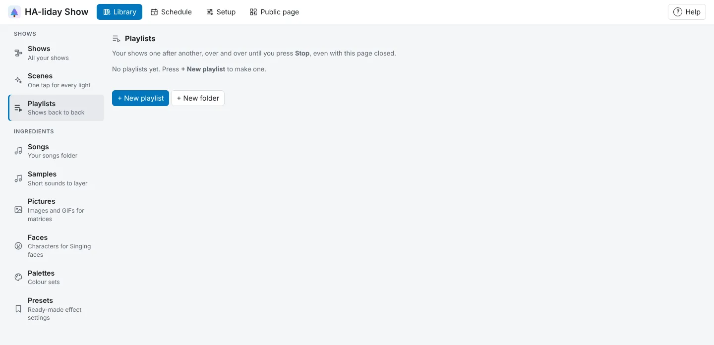

<!-- The user guide is written here, a page per topic. tools/check_guide.py checks its links. -->

# Playing shows and playlists

Save and play shows, and put them back to back in playlists.

## Saving

**Save** stores the show and bakes every frame for playback (Play saves first if
needed). With **Auto save** on in the show's settings (the default), the show also saves itself a couple of seconds
after each change and when you switch shows; the note next to it says whether everything is saved.
A new show is saved once it has its first effect. Auto save waits while a show is playing.

When you've changed a show (or your lights) and press **▶ Play** with **Lights** on, it gets the
lights ready first, which can take a little while on a phone or for a long show. The button says what
it's doing meanwhile (**Preparing…**, then **Sending…** with how far it's got) and turns to
**⏸ Pause** once the show starts. A show you open again with nothing changed since starts straight
away: HA-liday Show remembers which lights it was last got ready for. Likewise **Edit** in **Library → Shows** says **Opening…** while the show's song
arrives.

Whenever something saves (a show, your lights, palettes, presets, playlists or the house photo), the
top right of the page lights up green for a few seconds, then settles to a small **✓ Saved** with the
time, so you can always see when something last saved. If a save fails, or something else goes wrong,
the message shows in red and stays until you press it, or until the same thing works again. A nudge
such as "Choose a song first" shows in orange and fades by itself.

## While you edit

The Playback panel chooses where the song plays. This is kept in your browser
and never changes where the real show plays:

- **Song in this browser**: the song plays in your browser and HA-liday Show streams the lights in
  sync. Turn off **Lights** to preview in the browser only. If the lights lead or lag, adjust
  **Light offset** under **Setup → Speakers**. The 🔊 slider next to the clock sets how loud the song
  plays in your browser. The **Music editor** shares the same level, and your browser remembers it.
- **Speaker: …**: HA-liday Show starts the song on that speaker and the lights with it, and the
  playhead follows along. Line the lights up with the speaker's **Delay ms** under **Setup →
  Speakers** (also shown under Timing there while that speaker is picked).

## The real show

**Show speaker** in **⚙ Show settings…** (Show panel) is where the song plays when the show is
started from an automation or the MQTT Play button. Leave it on **Default** to use the default show
speaker from the Speakers tab, or pick a speaker for this show only. So you can design on a speaker
indoors and the real show still plays outside. With no show speaker and no default, the lights play
on their own.

## Playlists

To play several shows back to back, open **Library → Playlists**. A playlist plays round and round until
you stop it; if HA-liday Show restarts meanwhile (after an update, say), it picks up from the show or block
it was on, and a scene that was on comes back too. Each playlist says how many shows it has, how
long it takes to play through once and when it plays, with **Edit**, **▶ Play**, and under **⋯**, **Rename…**, **Duplicate** (a copy called "… copy", not on the
schedule) and **Delete…**. Press
**+ New playlist**, or **Edit** one:

- **Building blocks**, at the left to start with, go between your shows (see below). Drag one in like a show.
- **Your shows**, below them, lists every show, in the same folders as **Library → Shows**: press a folder
  to go into it, and a name in the path above the list to go back up. Drag one by its card into
  **Running order** and let go where it should play; a blue line shows where it will land. Or press **+**
  to add it at the end. **Find a show** looks in every folder, and says which folder each match is in.
  The same show can go in more than once.
- In **Running order**, drag a show or block up or down to change when it plays, or drag it out of
  **Running order** (back to **Your shows**, say) to take it out. **↑**, **↓** and **✕** do the same with a press. On a phone or tablet, drag
  by the dots (⠿) at the left of a card, so the page still scrolls; there, **Running order** comes
  first and **Building blocks** starts folded.
- The coloured bar above the order shows one time through, each show and block as long as it plays,
  and next to **Running order** it says how long that takes.
- Type over the name at the top to rename the playlist. **Delete playlist** removes it but keeps its
  shows. **← All playlists** (or your browser's **Back**) goes back to **Library → Playlists**.

Changes save as you make them. A playlist holds up to 100 shows and 200 things in all, and you can
have up to 50 playlists.

**Building blocks** fill the time between shows. Each has its own length in **seconds** (up to an
hour), set on its card in **Running order**:

- **Pause**: your lights go back to how they normally look.
- **Colour**: every light shows one colour. Click the colour box on its card to pick it.
- **Off**: every light goes dark.
- **Effect**: an effect plays on every light, such as **Twinkle** or **Rainbow**. Press the effect's button
  (**Change…**) to open the same window as in the Show editor, with moving previews of each effect; tick
  **Show presets** for its ready-made settings, your own presets too. Its colours carry over when you
  change effect, and for effects with colours, **Colours…** picks them from your palettes. An effect longer than a minute repeats every
  minute or so, at a point where the join doesn't show.
- **Scene**: one of your [scenes](scenes.md) plays, going round as it does on its own, at your scenes'
  brightness. Press **Change…** on the block's card to pick it: the window shows your scene folders, opening
  in the one the current scene is in, and **Find a scene** searches them all. It needs at least one scene, made in the **Scene** editor. If
  the scene is deleted later, the block says so and is skipped until you pick another.

Put a block wherever you like: between every show, only before the first, or several in a row (a
colour, then off for a moment, say). A playlist doesn't need any shows: one made only of scene blocks
plays your scenes in turn, on **Play** or on the schedule. Colour, Off and Effect blocks are got ready in your browser, like a show
when you save it: whenever HA-liday Show is open, and straight after you change a block or your
lights. A block that isn't ready yet (if you add lights and don't open HA-liday Show before the
playlist plays, say) is skipped. Playlists made before blocks have a **Pause** after each show,
as long as their old **Pause between shows**.

Press **▶ Play** and HA-liday Show plays the shows in order, then starts again from the top, until
you press **■ Stop**. It carries on with the page closed. A line at the top of **Library → Playlists**
and the Playlist editor says what's playing (a show or a block), which is also outlined in **Running order**. Each show plays on its own **Show speaker**, just as when an automation starts it.
Only saved shows play: a show you haven't saved yet, or have deleted, says so in the list and is
skipped. Playing a show from the editor, or stopping it, stops the playlist, and so does pausing or
stopping the song on the speaker.

### Music with no speaker: the Show player

A show with no **Show speaker** (and no default one under **Setup → Speakers**) plays its lights only
when a playlist, its schedule or an automation starts it. Without Home Assistant, that's every show.
To hear the music too, use the **Show player**:

1. On a computer or tablet connected to your speakers, open the **Show player** link under
   the **Schedule** tab. Without Home Assistant, the address is `http://<HA-liday Show's address>:8099/player`.
2. Press **▶ Start the Show player** (browsers only play sound after a press on the page).
3. Leave it open. Each song plays there from the right point, and your lights follow it.

Keep that computer from going to sleep while your shows run. If the lights are ahead of the music,
make **Light offset** bigger; if they're behind, make it smaller. Shows you play from the editor, or
on a speaker, don't play in the Show player, so you never hear a song twice.

<!-- nav: made by tools/check_guide.py -->

---

← [Effects](effects.md) · [Contents](README.md) · [Scenes](scenes.md) →
<!-- /nav -->
