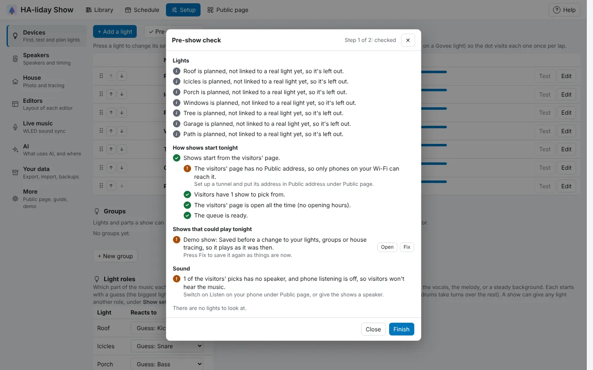

<!-- The user guide is written here, a page per topic. tools/check_guide.py checks its links. -->

# Pre-show check

Check everything's ready before the night's shows.

Before your lights go on for the night, press **✓ Pre-show check** at the top of the **Devices** tab. It
takes a few minutes, in up to four steps:

1. **Checking.** Without you doing anything, it:
   - asks every light whether it's there: Govee lights by a network scan (then directly at its address,
     if the scan didn't hear it), WLED and Twinkly lights directly, and Home Assistant lights by whether Home Assistant says they're available. Pixel
     controllers (DDP and E1.31) can't be asked, so you watch them in the next step. A Govee light that
     doesn't answer is amber, not red, and you watch it in the next step too: some networks (such as
     lights on their own VLAN) let commands reach it but not its answers back, so shows still work. Planned lights and
     props whose season is packed away are left out.
   - checks each WLED's **Wi-Fi sleep**. With it on, the WLED's Wi-Fi dozes between packets and frames
     arrive in bursts, which shows as stutter. It's amber, with a **Fix** button that ticks **Disable WiFi
     sleep** in the WLED's own settings and restarts it (about 10 seconds). You only need to do it once.
   - checks **How shows start tonight**, as far as you've set it up. With the visitors' page switched on,
     it checks the page is running and answering, can be reached at its **Public address**, is open
     tonight, has shows to pick and has its queue ready. With rows switched on in the **Schedule**, it
     checks one starts a show tonight. Either is fine on its own. With neither, it's amber, not red:
     nothing will start shows unless you start them yourself or from Home Assistant.
   - checks the shows that could play tonight (the visitors' picks and tonight's schedule), as
     [**Check all shows**](show-editor.md#checking-your-shows) does, under **Shows that could play tonight**.
   - checks the sound: each speaker tonight's shows play on, when a show uses one, and with the
     visitors' page on, that phone listening is on (or that visitors' picks have a speaker instead) and
     the songs are there.
2. **Looking.** Each light that answered (and each pixel controller) blinks white in turn: press **Yes**
   if you see it, **No** if you don't or only part of it lights, or **Skip**. After **No**, **Check
   segments** runs on it so you can see which part works. This stops anything that's playing.
3. **Timing with your phone**, when the visitors' page and **Listen on your phone** are on. Stand where you
   can see your lights, open the visitors' page on your phone, and press **Start the timing test**: every
   light flashes white once a second for half a minute. Press **Listen** on your phone (it shows once the
   test is playing) and it beeps. Then say whether the beep lands on the flash:
   - **Beep comes first** or **Flash comes first** moves every phone's music a tenth of a second the
     right way. Listen to a few more and answer again; the test starts again by itself if it runs out.
   - **Yes, in time** keeps that timing for every phone, visitors' too.
   - **Can't hear it** or **Skip this step** leaves the timing as it was.
4. **Results.** Everything in green (fine), amber (worth a look) or red (needs fixing), problems first,
   each with what to do about it. **Run again** starts over.

Under the button, **Devices** shows what the last check found and when, such as "Last checked tonight at
18:40: all good".

Some kinds have a little more in their window: **first LED** for a pixel controller over DDP, **universe**
and **channel** for one over E1.31, and the light or switch for a Home Assistant one.

<!-- nav: made by tools/check_guide.py -->

---

← [Schedule](schedule.md) · [Contents](README.md) · [The public page](public-page.md) →
<!-- /nav -->
