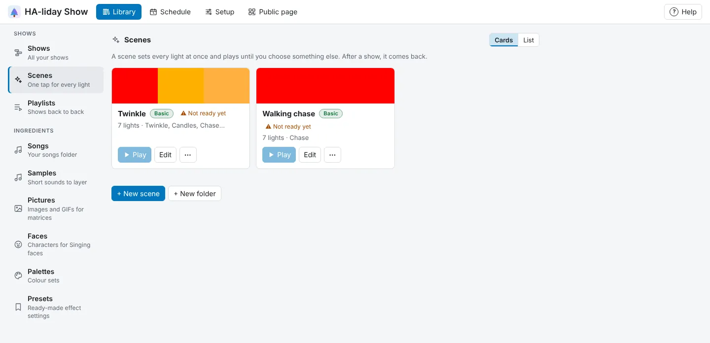
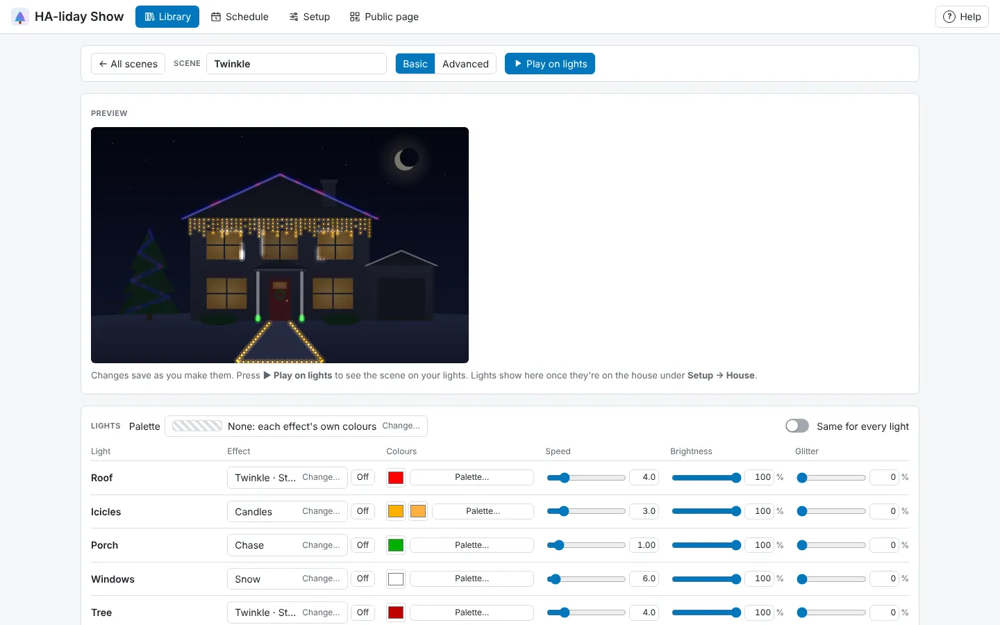

<!-- The user guide is written here, a page per topic. tools/check_guide.py checks its links. -->

# Scenes

One-tap looks for every light.

A scene sets every light at once, like a preset in WLED or a one-tap scene in a lights app, and
plays until you choose something else. Use one for the hours your lights are on between shows.

Your scenes are under **Library → Scenes**, and **Edit** opens one in the **Scene editor**. Each scene shows its colours, a **Basic** or **Advanced** pill (which editor it was made in) and what it plays, with **▶ Play** (or **■ Stop**
while it's on), **Edit**, and under **⋯**, **Rename…**, **Duplicate** (a copy called "… copy", ready to play
and not on the schedule) and **Remove…**.

- **+ New scene** takes three steps, like **+ New show**: its name, its colours, then **Basic** (a row
  per light, below) or **Advanced** (straight into the Show editor, further down). The palette starts on
  the season's, or the one you last used. Each light starts on a steady colour from it, one colour after
  another along your lights. Pick **None** and every light starts on a warm white instead. Either way it does something the moment you play it.
- **Palette**, above the lights, is the scene's palette, as a show has one. Any effect you pick for a
  light takes its colours, going round the palette from light to light, and the effect window shows
  every effect in them. That includes **WLED's own effect**, which then uses the WLED palette
  **\* Colors Only**, so the WLED draws in your colours. Change the palette and you're asked whether to
  recolour the lights already on. You can still set a light's own colours afterwards with its colour
  boxes or **Palette…**.
- In the editor, each light has its own row: its **Effect**, its **Colours** (a colour box for each,
  and **Palette…** to use one of your palettes), and **Speed**, **Brightness** and **Glitter** sliders
  (white sparkles over the effect; all the way left is none). A light on **WLED's own effect** has
  **Speed**, **Brightness** and **Intensity** instead, named on its row: its Speed and Intensity are the
  WLED's own sliders for that effect, and there's no Glitter, as it can't reach the WLED. Press the
  effect to change it: the same window as the Show editor's opens, with every effect moving in the
  light's own colours. Tick **Show presets** there to pick a preset; the effect then shows its name,
  such as **Three colours · Still blocks**. **Off** beside it turns the light off in this scene.
- A light split into parts plays one look across the whole light. Turn on **Each part on its own**
  under its name to give every part its own row instead, each starting on the light's look. A light set to play only as parts always
  has a row for each part.
- A light not split into parts can play a **Live music** effect that follows what a WLED with a
  microphone hears (see [Live music effects](live-music.md#live-music-effects)). Its row then has **Follows** (and
  **Fills** or **Burst**) under the effect.
- A WLED light can play one of **WLED's own effects** instead: pick **WLED's own effect** under
  **On this WLED**, the blue box at the top of the effect window. A light split into parts offers it on its own row (with
  **Each part on its own** off), and the WLED plays it across all its segments. With **Each part on
  its own** on, each part made from the WLED's segments (with **Fetch segments**) can have its own:
  say Fire on Left and Twinkle on Right. Parts you drew yourself don't offer it. The **WLED effect** window
  then opens: every effect the WLED has, read from the light itself (so the light needs its IP address),
  each moving as the WLED draws it in the light's colours. Type in **Find a WLED effect** to narrow them
  down, and press one to pick it. To change it later, press its name (**Change…**) under **WLED's own
  effect**. The button under that, with a strip of colours, is the WLED's palette: press it to see every
  palette your WLED has as a strip of its colours, and pick one. **Default** shows the colours the effect
  uses when no palette is picked. Its colours,
  **Speed**, **Brightness** and **Intensity** go to the WLED too. When the scene starts, HA-liday Show
  tells the WLED to play that effect and sends it nothing else; your other lights play as usual. Each WLED
  keeps its own look even if your WLEDs sync with each other (WLED's **Sync Interfaces**): HA-liday Show
  asks it not to pass the look on. The
  **Preview** shows the effect moving as the WLED draws it, worked out with WLED's own code, for all of
  WLED's effects for a strip of lights (such as **Fire 2012**, **Pacifica**, **Twinklefox**, **Aurora**,
  **Noise 1** to **4**, **Bouncing Balls**, **Halloween Eyes** and **TV Simulator**). The 2D, sound-reactive
  and particle (**PS**) effects show a rough stand-in, their palette or colours drifting along the light,
  and the light's row says so. On the **Default** palette, some effects (such as **Fill Noise**) show a
  single colour, on the WLED as in the preview: pick a palette to see them properly. When it
  switches the WLED to an effect, HA-liday Show also has the WLED load that effect's own settings for
  its extra sliders and options (your speed, intensity, palette and colours still apply), so effects
  such as **Palette** and **Scanner** play as WLED intends; the preview uses the same settings.
  WLED's sound-reactive effects follow the WLED's own microphone, while **React to music**, the scenes'
  brightness, and House lane or group lane effects don't reach this light. When a show starts, the
  light is taken back as usual. When the scene stops, the WLED carries on with its effect (as a WLED
  goes back to its own effect after a show), so turn it off in WLED or Home Assistant if you want it
  dark. A WLED that doesn't answer just stays as it was. On a WLED you've added as a light per segment,
  only that light's segment plays the effect. Your other lights on the same WLED (and the light's
  other parts) can't get frames while it does (they'd stop the effect), so they show what WLED has set
  for their segments, unless you give them WLED's own effect too; their rows say so.
- **Same for every light** puts one row in charge of all your lights. Turn it off again and each
  light starts from that look, ready to change one at a time.
- The **Preview** shows the scene moving on your house photo. Changes save as you make them.
- **▶ Play on lights** plays it on your real lights, round and round. Change it while it plays and
  the lights follow.

**Advanced** (beside the scene's name) opens the scene in the **Show editor**, for a scene that changes
over time or runs across the house: effects can start and stop on the timeline, and the **House** lane
works as in a show. Each light's look becomes one effect across the whole timeline to start with.

- The banner under the Show panel's title has the scene's **Palette**, which works as a show's does:
  effects you add take its colours.
- The timeline is one time round. The banner says how long:
  **Goes round every** 20 seconds to start with, up to 10 minutes. Making it shorter cuts effects at the
  new end; dragging an effect past the end makes it longer.
- There's no song, so the song, beats, ✨ **Generate** and **⚙ Show settings…** are hidden, and
  **Loop** is on. **▶ Play** plays the scene on your lights from the playhead; **⏸ Pause** turns it off.
- It saves as you go, like a show. **← All scenes** goes back to the list, where **Edit** opens it in
  the Show editor again.
- On a WLED light's own lane, the effect window offers **WLED's own effect**, as in a Basic scene. A
  light split into parts offers it on its own lane, and its parts' effects then don't play. Each part
  made from the WLED's segments offers it on its own lane too. It always covers the whole loop and is that lane's only effect: picking it replaces the
  lane's other effects, and other effects can't go on that lane until you change or delete it. Its clip
  says **WLED:** and the effect's name, and the **Selection** panel picks the WLED's effect and palette.
  Transitions and Glitter do nothing on it, and it can't be copied to other lights or saved as a preset.
- **Switch to Basic** goes back to a row per light. It's only offered while nothing would be lost: each
  light with one effect across the whole loop, played on the whole light, and nothing on the House lane.

Scenes come on and off by themselves from the [Schedule](schedule.md) tab. **When it plays** at the foot
of the Scene editor (or **Schedule…** in the banner for an Advanced scene) says what the schedule does
with the scene, with **+ Add to schedule** and **Open Schedule**. **Library → Scenes** says it too.

Scenes are also in Home Assistant, as a scene each and one light whose brightness dims them (see
[With MQTT](home-assistant.md#with-mqtt)).

While a scene is on, starting a show or a playlist (from an editor, an automation, a schedule or a
visitor) takes the lights over. When it finishes, or you stop it, the scene comes back after a
couple of seconds, and its row says **Comes back after the show** meanwhile. To turn the lights off,
press **■ Stop** on the scene, or **Stop** while only the scene is playing. **Remove…** deletes a
scene for good, keeping a copy of all your data first under **Setup → Your data**.

Scenes are made for the lights you have when you edit them. If you add or change lights, open
HA-liday Show and scenes are made again for the new lights.

<!-- nav: made by tools/check_guide.py -->

---

← [Playing shows and playlists](playing.md) · [Contents](README.md) · [Live music](live-music.md) →
<!-- /nav -->
