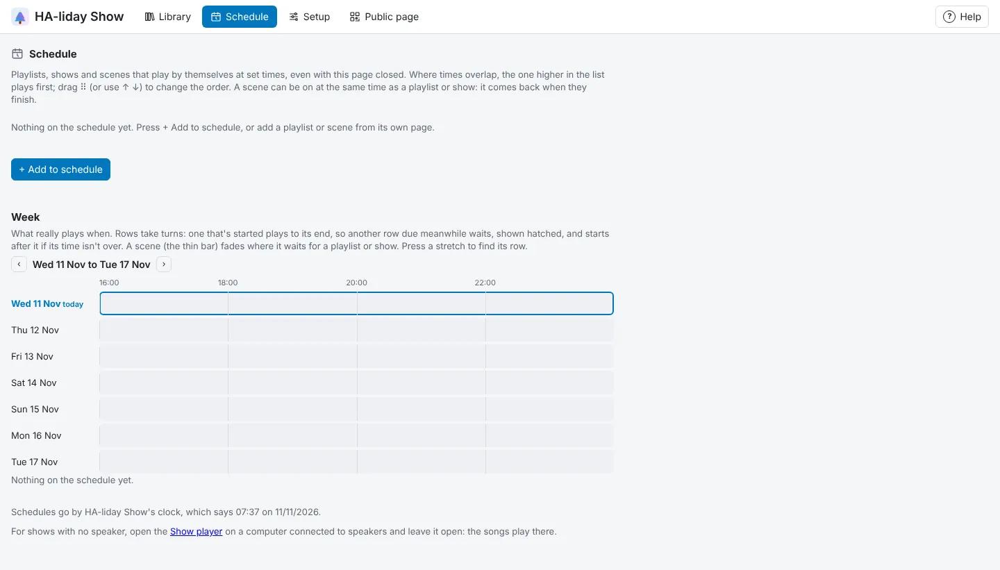

<!-- The user guide is written here, a page per topic. tools/check_guide.py checks its links. -->

# Schedule

What plays by itself, and when.

The **Schedule** tab is where playlists, shows and scenes play by themselves at set times, even with
the page closed. Each row is one thing it plays, then its times, days and dates.

- Press **+ Add to schedule**, then pick what it plays: a playlist, a show (it plays round and round
  for the whole time) or a scene. The window has a tab for each, showing your folders from the
  Library, and **Find by name** looks through all three and every folder. To change what a row plays, press its name. **+ Add to schedule** under **When it plays**, in the Playlist editor
  or the Scene editor, adds that playlist or scene.
- The same thing can be on the schedule more than once, such as your playlist 17:00 to 22:00 on
  weekdays and 16:00 to 23:00 at weekends.
- Untick **On** to pause a row without losing its times. **Delete** takes it off the schedule.
- A row whose playlist, show or scene you delete stays, greyed out, and is skipped.

Times work like this:

- **From** and **to** set the times, such as 17:00 to 22:00. An end time earlier than the start runs
  past midnight: 20:00 to 01:00 on a Saturday plays until 1 in the morning on Sunday.
- To start when it gets dark, change **From** to **sunset**. You can start up to 3 hours before or
  after it, such as 15 **minutes after**. Sunset moves through the year, so the row does too.
  An end time in the morning (before 12:00), such as 01:00, is the next morning. On an evening the sun
  sets after the end time (21:00 in midsummer, say), it doesn't play.
- Press the days it shouldn't play to turn them off.
- Turn on **Only between** to play just between two dates, such as 25 Oct and 31 Oct. They come round
  every year, and can run over New Year (1 Dec and 6 Jan).

Each row says when it next starts. At the start time a playlist or show starts, even if something else
is playing. At the end time the show that's on finishes, then it stops (a building block that's on
stops straight away), unless another row for the same thing carries straight on. If you press
**■ Stop**, pause the song on the speaker or play something else in between, it stays off until its
next start time. If HA-liday Show restarts during the scheduled time (after an update, say), it
picks up from the show or block it was on, and a row you turn on during its time starts too. One whose
end time passed while it was restarting stays off. Changing the times while it plays
just moves when it stops.

A scene row puts the scene on at its start and off at its end. If a show or playlist is playing,
the scene waits for it to finish. If you turn it off, or put another scene on, before then, it's left
that way until its next start.

## When times overlap

Playlists and shows take turns, and so do scenes; a scene can be on alongside a playlist or show.

- Where two playlists' or shows' times overlap, the row higher up the list plays first, and the
  other starts once it's finished. The same goes for two scenes. Drag ⠿ (or press **↑** and **↓**) to
  change the order.
- A playlist or show takes the lights over from a scene, and the scene comes back once it's finished.
  For example: **Candy cane** from sunset to midnight, and your show playlist from 18:00 to 20:00. The
  lights glow from sunset, the shows take over at six, the scene comes back once they've finished, and
  everything goes off at midnight.

## The week

**Week**, under the list, shows what really plays when over seven days from today, a row per day.
Each row of the schedule is a bar in its own colour, with its name; a scene is the thin bar along the
bottom.

- Rows take turns, as the schedule really plays them: a row that has started plays until its end
  time, so another row due meanwhile waits, even if it's higher in the list. The time it waits is
  hatched in its colour, and it starts after the first one if its own time isn't over by then. A row
  whose whole time passes while another plays is only hatched: it doesn't get a turn that day. Where
  two rows are due at the same moment, the one higher in the list goes first.
- A scene's bar fades where it waits for a playlist or show to finish.
- Times that run past midnight carry on past **00:00** on the day they start, and sunset times move
  from day to day as they really do. A row that starts at sunset needs to know where you are (below).
- Rows switched off, and rows whose playlist, show or scene has been deleted, aren't shown.
- Hold the pointer over a bar for its times, and press it to find its row in the list. **‹** and **›**
  move a week at a time, and **From today** comes back.

## Sunset and the clock

Sunset times are worked out for Home Assistant's location (**Settings → System → General** in Home
Assistant). Without Home Assistant, or to use another place, type your latitude and longitude in the
boxes at the bottom of the **Schedule** tab (they appear once a row starts at sunset), and press
**Save**. **Use Home Assistant's** goes back to Home Assistant's location. On Google Maps, right-click
your house and click the numbers at the top to copy them, then paste them into the first box. Sunset
is worked out to within a couple of minutes. The page shows today's sunset next to the clock.

The schedule goes by HA-liday Show's own clock, which the **Schedule** tab shows. The app uses Home
Assistant's time zone. With Docker, set `TZ` in `docker-compose.yml` to your time zone (such as
`Europe/London`); with Python, it uses your computer's clock.

Schedules you'd set on a playlist or scene before 0.2.233 were moved to the **Schedule** tab for you.

<!-- nav: made by tools/check_guide.py -->

---

← [Live music](live-music.md) · [Contents](README.md) · [Pre-show check](pre-show-check.md) →
<!-- /nav -->
