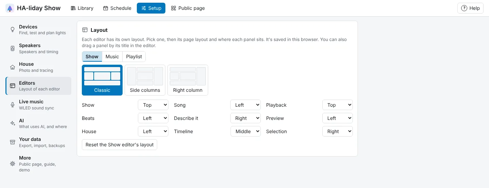
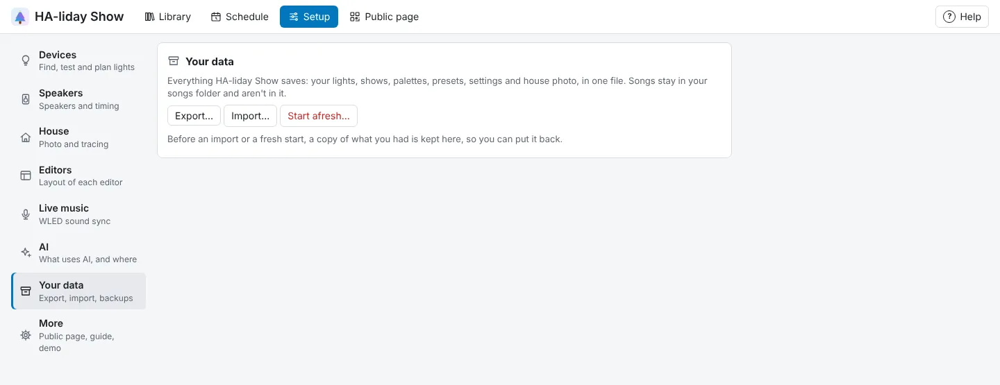

<!-- The user guide is written here, a page per topic. tools/check_guide.py checks its links. -->

# Settings and your data

Arrange the editor, change settings, and export or import everything.

## Arrange the editor

The Show, Music and Playlist editors are all made of panels you can arrange, and each editor keeps its
own arrangement:

| Editor | Panels | Can't be hidden |
| --- | --- | --- |
| Show | Show, Song, Playback, Beats, Describe it, Preview, House, Timeline and Selection | Timeline |
| Music | Song (with **Make song file**), Playback, Waveform (with the **Mixer**), Selection, Beats and sections, Edit, Add another song and Smoothing | Waveform |
| Playlist | Playlist (its name, **▶ Play** and **Delete playlist**), Building blocks, Your shows, Running order and When it plays (what the schedule does with it) | Running order |

The Music editor's **Selection** panel is where you change whatever you clicked: a section, a ⚑ mark, a
clip on a layer or a ✂ join, and the **EQ** faders. If it's folded, clicking one opens it; if you've
hidden it, bring it back to use them.

Drag any editor panel by its
title to move it to the top, left, middle, right or bottom, or to change its order there; a blue
bar shows where it will land. The **⋯** button in its corner does the same from a menu: it shows a
small picture of the page, so click the area you want the panel in. **Earlier** and **Later**
change its order, which also works on a touch screen. Any panel except the Timeline can be
**Hidden**. To keep a panel to hand but out of the way, press the **▾** before its name to
collapse it to its title, and **▸** to open it again. On a phone, some panels start collapsed so the
main one is near the top: **Preview** and **House** in the Show editor, **Add another song** and **Smoothing** in
the Music editor, and **Building blocks** in the Playlist editor. Open them with **▸** whenever you want
them.

Each editor panel has a **?** beside its **⋯**: it shows a few tips for that panel, and **More in Help →**
opens the rest in the **Help** drawer (see [Help](getting-started.md#help)).

The **page layout** sets how those five areas fit together. Pick it at the bottom of any panel's
**⋯** menu or under **Settings → Layout** (each editor has its own):

| Page layout | Arrangement |
| --- | --- |
| Classic | Top and bottom run the full width; left, middle and right sit side by side between them. |
| Side columns | Left and right run the full height of the page, with top, middle and bottom stacked between them. |
| Right column | Right runs the full height; top and bottom span the left and middle. Handy for keeping Selection beside everything. |

Out of the box, in the Show editor, the Show and Playback panels run along the top, Song, Preview, House and Beats sit
down the left, Selection and Describe it down the right, and the Timeline takes the middle, so the
timeline and the selected clip are on screen together. The Music editor starts with Song and Playback
along the top, the waveform in the middle with Selection beside it, and the other panels along the
bottom; the Playlist editor with Building blocks and Your shows down the left, the running order in the
middle and When it plays along the bottom. Each editor's **Reset** button under **Settings → Layout**
goes back to these. While the top area is
short enough, it stays in view as you scroll, so **Play** is always to hand.

An area with no panels in it takes no space. On a narrow screen every area stacks in one column. With Selection hidden, clips can still be moved, resized, copied and
deleted on the timeline, but adding or editing effects needs it back. The layout is saved in your
browser, so each computer or phone keeps its own.

## Settings

The rest of **Setup** is in its own tabs, one subject each. Timing and Automations sit with the speakers, under **Setup →
Speakers**: **Light offset** for playing in the browser (positive values delay the lights), or the
picked speaker's delay, and the exact `hassio.app_stdin` input for the open show.

| Tab | What's there |
| --- | --- |
| **Editors** | Pick **Show**, **Music** or **Playlist**, then that editor's page layout, where every panel sits (including hidden ones) and its **Reset** button. |
| **Live music** | What a WLED with a microphone hears (see [Live music](live-music.md)). |
| **AI** | Which AI the ✨ features use (**Describe it**, Generate's **AI** option and the rest), or how to set one up (see [Setting up the AI](ai.md)). |
| **Your data** | **Export…**, **Import…** and **Start afresh…**, and the copies kept before an import or a fresh start (see [Your data](#your-data)). |
| **More** | **Public page**: **Let visitors start shows**, which adds the **Public page** tab (see [The public page](public-page.md)). **Setup guide**: **Run the setup guide**, the step-by-step window that opens on a fresh install (see [Quick start](getting-started.md#quick-start)). **Demo**: **Try the demo** on a fresh install, or **Remove the demo** (see [The demo](getting-started.md#the-demo)). **Experimental**: **Show the Labs tab**. |

**Labs** is a tab under **Setup** for working out new ways to drive Govee lights. It's hidden until you
turn on **Show the Labs tab** under **More → Experimental**; that's saved in this browser, so each computer or
phone has its own. It holds:

| Section | What's there |
| --- | --- |
| Packet lab | Sends hand-made messages to one Govee light, for trying out new ways of driving it (below). |
| Listen for Govee traffic | Records what your Govee lights say to each other, to help support new ways of driving them (below). |

## Your data

**Setup → Your data** puts everything HA-liday Show saves in one file, and back:

- **Export…** downloads a `.zip` of your lights (with their parts and groups), shows (archived ones
  too), scenes, palettes, presets, playlists, the schedule, settings (the public page's and your
  song folders and your Library folders too), the Music editor's drafts, what **Detect** found in each song and your notes on it, the house photo and where each light is traced
  on it, and the public page's own picture. Your songs stay in your songs folder and aren't in it.
  It's the same on every install, so you can move your shows to another Home Assistant, or between
  HA-liday Show and a Docker or pipx install.
- **Import…** replaces all of that with what's in an exported file. A file that isn't an HA-liday Show
  export is refused and nothing changes. A big file goes up in pieces, so it takes a moment; the
  status line shows how far it's got.
- **Start afresh…** removes it all, so HA-liday Show is like new and the setup guide opens. It also resets
  this browser's layout and choices (like **Show the Labs tab**). Your songs are kept.

Before an import, a fresh start or deleting a show or song for good, HA-liday Show keeps a copy of what
you had, listed under **Your data**
(the newest five). **Put back** restores one, **Download** saves it as an export, and **Delete** removes
it for good (after asking) when you don't need it. So to try the
setup guide without losing anything: **Start afresh…**, try it, then **Put back** the copy *Before a
fresh start* (or **Import…** your export).

Home Assistant's own backups include all of this too, as the app's config folder.

## Moving from Govee Light Show

This app used to be called **Govee Light Show**. Home Assistant treats the renamed app as a new
one, so you install **HA-liday Show** alongside the old one:

1. Stop **Govee Light Show**, so only one app drives your lights.
2. Install **HA-liday Show** and start it. The first time it starts, it copies your shows, lights,
   palettes, presets, settings, house photo and songs across from the old app. The old app's
   copy isn't changed.
3. In **HA-liday Show**'s **Configuration** tab, paste your **Claude API key** again if you use one,
   and turn on **Show in sidebar** and **Start on boot**.
4. If you use MQTT, the old **Govee Light Show** entities are removed and new **HA-liday Show** ones
   appear (for example `select.ha_liday_show_show`). Point your automations at the new ones, and
   change the app in any `hassio.app_stdin` (or older `hassio.addon_stdin`) action to **HA-liday Show**.
5. Once your shows play as before, uninstall **Govee Light Show**. Your songs stay in
   `/media/govee_show` until you delete them; the new app uses its own copies in
   `/media/haliday_show`.

The copy only happens once, and only if **HA-liday Show** has no lights or shows of its own yet.

<!-- nav: made by tools/check_guide.py -->

---

← [Dashboard cards](dashboard-cards.md) · [Contents](README.md) · [Setting up the AI](ai.md) →
<!-- /nav -->
