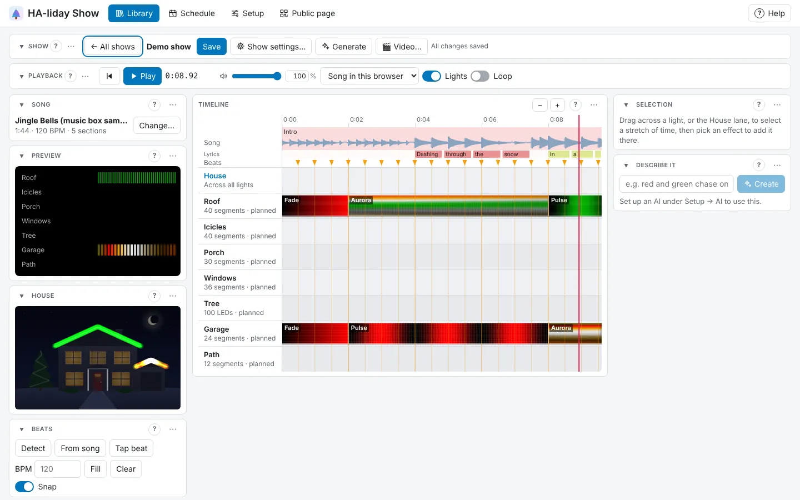
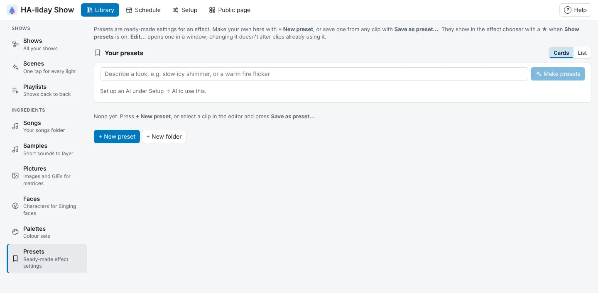
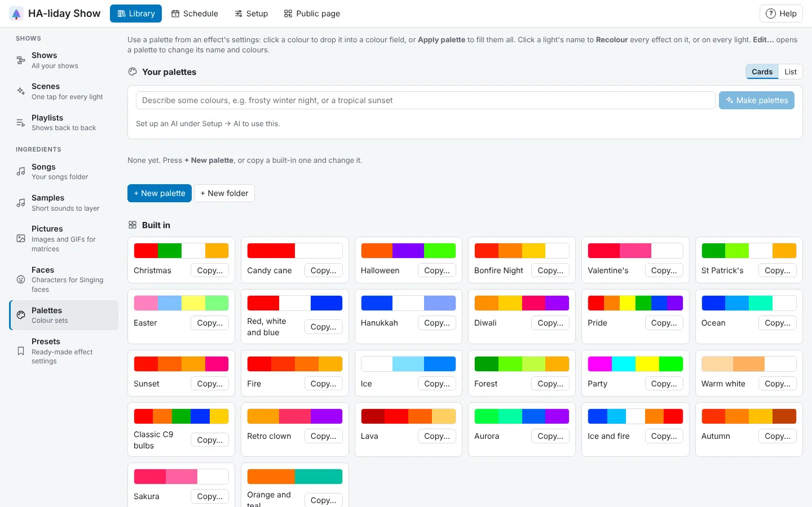

<!-- The user guide is written here, a page per topic. tools/check_guide.py checks its links. -->

# The Show editor

The timeline, adding and editing effects, presets and palettes.

## The timeline

Each light has a track, with the **House** lane at the top. The timeline is never taller than
your screen: with lots of lights it scrolls them inside itself, and the times, song and beats stay at
the top. Scroll through the lights with the mouse wheel over their names (or drag the scroll bar), and
along the song with the wheel over the tracks; zoom with the **−** and **+** buttons in the Timeline panel, the + and − keys, or
Ctrl+wheel (or a trackpad pinch) around the pointer. Click the ruler to move the playhead. The **▸**
before **House** folds the [group lanes](effects.md#group-lanes) away, and the one before a split light's name
folds its parts (see [The whole light as one](organising-lights.md#the-whole-light-as-one)); **▾** brings them back.

## Adding effects

Drag across a light's track to select a stretch of time (drag up or down to
cover several lights; a plain click selects up to the next beat; hold **Alt** to start a selection
on top of an existing clip). Press **＋ Add effect…** in the Selection panel to open the effect
chooser: a button for every effect, each with a strip playing it on that light for the selection's
length, so you can see it first. Click one to add it (Esc or ✕ closes it without adding). The last
effect you added also gets an **Add … again** button, for laying down a run of the same thing. With
the House lane and lights selected together, the chooser has a section for each. To clear a stretch,
select it and press **Delete effects here** or the Delete key: effects inside it are removed and
ones crossing its edges are trimmed.

## Editing a clip

Click a clip to select it. Drag it to move it (onto another light too), drag
its edges to resize it (where it touches the next effect, dragging the join moves both, so no gap
opens up; hold **Ctrl** to move just the one), and change its effect, colours and settings in the
Selection panel. While a
clip is selected it loops on its own in a strip at the top of its settings, so changes show
straight away. To swap the effect, press **Change…** beside **Effect**: it opens the same effect
chooser used to add one, playing on that light for the clip's length, with the current effect
outlined. Changing effect keeps the clip's colours, brightness and transitions.

On a shaped prop (a star, wreath or spinner), the clip's preview is the shape, and **Runs** picks how a
strip effect plays over it: **Along the wire** (the default, LED 1 first), **Round the shape** (a chase
goes round, and a wreath's rings go round together), **Out from the middle** (a spinner's arms light out
together), **Along each arm** (each star point or spinner arm from the middle to its tip), **Left to
right** or **Top to bottom**. Effects made for matrices, such as **Fire** and **Snowfall**, and House
patterns are drawn across the shape, each LED taking the colour of its spot.

On a matrix, the clip's preview is the grid itself, and so are the moving previews in the effect window
and the clips on the timeline (a row of little grids along each clip, each a moment of it). **Runs** picks
how a strip effect plays on it:
**Along each row** (every row the same, the default), **Down each column** (every column the same,
good for a mega-tree's strings) or **Whole matrix as one strip** (it zig-zags through the rows, so a
chase or a wipe goes round the whole grid). House patterns, such as **Stripes**, **Chequerboard**,
**Colour wave**, **Spotlight** and **Spiral**, don't need it: on a matrix's own lane they're drawn across
the grid, as they are across the house. **Spiral** winds stripes round a mega-tree and turns them
(try its **Candy cane** and **Twirl** presets); for a tree that fills up from the bottom, use **House
wipe** going **bottom to top**. **Plasma** and **Spiral** are also listed under **On a matrix** in a matrix's own
effect chooser, so you can put them on that light alone.

## Transitions

Under **Transitions** in the Selection panel, a clip can come **In** and go **Out** gently rather than
switching on and off. Pick how, and how many seconds it takes:

- **Fade**: the whole light at once.
- **Wipe** and **Wipe back**: along the light from one end or the other.
- **From the middle**: spreading out from the middle of the light.
- **Dissolve**: bulbs switching one by one in a random order.

When two clips are back to back on one light, the transition is a crossfade: the old look turns into
the new one with no dark gap. Use the second clip's **In** (or, if it has none, the first clip's
**Out**). On the House lane and group lanes, a clip fades in and out over the lights' own effects.
The timeline shows each transition on its clip.

## Glitter

Under **Glitter** in the Selection panel, any clip can sparkle: drag **Amount** to the right and white
sparkles twinkle over its effect, such as a red chase with glitter on it. More means more sparkles (up to
about a quarter of the bulbs at once). **Colour** changes the sparkles, gold or icy blue, say. All the way
left is no glitter. The sparkles follow the clip's **Brightness**, and come out the same every time, so
what you see in the editor is what your lights show. Glitter stays when you change a clip's effect, and
works on the House lane and group lanes too.

## Mixing lanes with the lights

A clip on the House lane or a group lane covers the lights' own effects by default. Under **Clip**,
**Lights' own effects** changes how it mixes with them:

- **Cover them**: the lane's colours replace the lights' own (as before).
- **Add to them**: both together, so a sweep of white brightens a red chase as it passes.
- **Brighter of the two**: whichever is brighter on each bulb.
- **Only where they're lit**: the lane's colours show only where a light's own effect is lit, at its
  brightness. A rainbow wave over a chase gives a chase in rainbow colours.

## Settings that change over a clip

Any number setting (a speed, a size, how many, brightness) can change over the length of a clip,
like xLights' value curves. Turn on **Changes** under the setting, give the value it should reach,
and pick how it gets there: **Steady**, **Ease in** (slow at first), **Ease out** (slow at the end)
or **Up and back** (to the new value halfway, then back again). For example, make a chase speed up
into the chorus, or let brightness swell and fade. A speed that changes moves smoothly from one
speed to the next, so nothing jumps backwards. The setting box keeps the value the clip starts at.

Previews show what the real light will do. A light on **Whole light (one colour)**, or a Home
Assistant light or switch, can only change a few times a second, so its previews (the timeline,
**Preview**, the house photo, the Selection strip and the effect chooser) step at that pace rather than
moving smoothly, and a **Whole light (one colour)** light shows the single colour it really will.

On one of these slow lights, the Selection panel warns **⚠ Too fast for this light** when a clip's effect changes
faster than that, such as a quick chase, sparkle or strobe. It would look steppy on the real light.
Slow the effect down, or use a fade, pulse or colour change instead.

House lane effects are checked the same way, light by light: the warning names each slow light the
effect is too fast for, such as **⚠ Too fast for Porch (a Home Assistant light)**. Realtime lights in the
same sweep or wave are fine.

## Effects a light can't show

Not every effect works on every light. A light set to **Whole light (one colour)** shows one colour at a
time, so a chase, comet or two-colour blocks come out as one steady colour. A light with only a few
segments can't show a chase wider than itself.

- In the effect chooser, effects that won't work on the light are greyed out. Click one to see why.
  Turn on **Allow effects that won't work** to pick them anyway.
- Effects that work, but not quite as meant (too fast for a slow light, a House lane effect that is
  too fast for one of your slow lights, or one that leaves out lights you haven't traced on the photo),
  are marked **⚠**.
- On the timeline, clips that won't work are hatched with a red corner and a **⚠**; ones that only
  partly work get an orange corner. Select one and the Selection panel says why. When you open a show,
  a message says how many of its clips won't work.
- Nothing is changed or removed for you: such clips stay in your show and play as before. They are
  marked again whenever you change a light under **Setup → Devices**, say from **Realtime** to **Whole
  light (one colour)**.
- **Copy to all lights**, paste and adding an effect to several lights at once leave out the lights it
  won't work on, and say which. **Generate** and **Describe it** only use effects that work.
- A light whose realtime mode only reaches part of it, like the 30 m Christmas String Lights 2 (H70C5)
  at 44 bulbs, shows **⚠ first 44 bulbs only** under its name on the timeline.

## Finding an effect

The effect chooser groups effects into boxes (**Basics**, **Movement**, **Sparkle and festive**,
**Calm**, **Follows the music**…), each with how many there are. Along its top, **Find an effect** looks
for a name, and the chips narrow the list to effects that are like that: **Moving**, **Sparkles and
twinkles**, **Flashing**, **Steady**, **Colourful**, **Calm**, **Lively** and **Follows the music**. Tick
more than one for effects that are all of them (**Sparkles and twinkles** and **Calm** gives Flicker,
Twinkle, Candles, Snow and Fairy lights). **Clear** shows them all again; the chips you ticked are
remembered for next time. Effects made for a matrix (**On a matrix**) are only offered on a light set
up as a matrix. **Allow effects that won't work** only appears when some effects can't work on the light
you're adding to (some Govee lights' limits); on WLED and other lights where everything works, it isn't
there.

## Presets

Most effects can look very different depending on their settings (Three colours can sit
still, alternate, or run as a slow or fast marquee). Turn on **Show presets** in the effect chooser and
each effect becomes its own boxed group: **Default** first, then its presets, each previewed. Picking
a preset sets just the settings it names. When adding an effect it uses the effect's default colours;
when changing a clip your colours stay. The Effect button shows the preset a clip matches, such as
**Three colours · Wide marquee**. The chooser remembers whether presets were showing.

Some presets come from WLED's favourites: **Heartbeat** (Pulse), **Meteor** (Comet), **Twin scanner** (Scanner)
and **Dark sparkle** (Twinkle: lit all over in your colour, with bulbs blinking out).

## Your own presets

Get a clip looking right, then press **Save as preset…** under its settings.
Name it and choose whether to **Include colours** (on by default; turn it off to save just the
movement and other settings, so the preset takes on whatever colours a clip already has). Your
presets appear in the effect chooser after the built-in ones, marked with a ★, and **★ My presets
only** narrows the chooser to them. If you've put your presets in folders under **Library → Presets**,
the folders show under the filters while presets are showing: press one to see only your presets in it
(still under their effects), and **All presets** to see everything again.

## The Presets tab

**Library → Presets** lists your presets by effect, each with a live preview, **Edit…**, and
**Rename…**, **Duplicate** and **Delete…** under **⋯**. **Edit…** opens the preset in a window with a larger preview (choose
which light's segments with **Preview on**). Rename it, change its **Effect** (or start again from one
of that effect's presets), turn **Include colours** on or off, and change its colours (palettes work
here too), settings and brightness; the preview follows every change. **Save** keeps the changes and
**Cancel** leaves the preset as it was. **+ New preset** starts one from scratch: pick an effect, or
any built-in preset, to start from, then **Add preset** in the window. Or describe a look in
the box above, such as "slow icy shimmer" or "warm fire flicker", and press **✨ Make presets**: the AI
suggests up to three, each with a live preview, and **Keep** adds one to your presets (it needs an AI
set up, as for **Describe it**). Changing or deleting
a preset doesn't change clips that already used it. They're saved in HA-liday Show, so every browser
sees the same ones.

Turn on **Show on the light** to loop it on the real light too while the show is
stopped; the light goes back to normal when you click away. Every effect has a **Brightness %**
slider, so one section can glow softly and the next hit full brightness.

## Copying

Select a clip, or click a light's name to select all its effects, press **Ctrl+C**,
click another light's name and press **Ctrl+V**. Pasted effects keep their times so the lights stay
in step; pasting onto the same light puts them at the playhead. With a light's name selected you
can also **Copy all effects to** another light or all of them, optionally replacing what they had.
Effects scale to each light's segment count. **D** duplicates the selected clip.

## Moving a stretch

To move a whole section of a show, select the stretch (drag across it, or hold **Alt** if you start
on a clip; drag up or down to take in several lights). Then either:

- **Drag it.** Press inside the selection and drag it to another light, or along to another time.
  Everything in it moves together, and with several lights selected they all move down or up together.
  A click inside the selection, without dragging, still selects the clip under the pointer.
- **Cut and paste it.** **Ctrl+X** cuts it (**Ctrl+C** copies it). Click another light's name and press
  **Ctrl+V**: it lands at the same times, so it stays in step with the music. Pasting onto the light it
  came from puts it at the playhead, and pasting onto a selected stretch puts it at that stretch's start.
  Several lights paste onto the light you clicked and the ones under it.
- **Move to.** In the Selection panel, pick a light under **Move to** and press **Move**. The effects
  keep their times. With several lights selected, the one you pick is where the top light goes.

Whatever was already there in that stretch is replaced, and effects crossing the selection's edges are
cut at them. Effects that won't work on the new light (a House effect onto a light, say) stay where they
were. WLED's own effect and Live music effects never move with a stretch. **Ctrl+Z** undoes the whole
move. **Ctrl+X** also cuts a single selected clip.

## Colour palettes

An effect's settings show the **Palette** in use, with its colours: press **Change…** to pick
another from a window of colour bars (built-in ones first, then yours, in your folders from
**Library → Palettes**: press a folder to go into it, and the heading to come back out). Click a colour to put it in
the colour field you last clicked, or press **Apply palette** to fill them all in order. Click a
light's name to **Recolour this light** or **Recolour all lights**: each light steps through the
palette effect by effect, so the lights stay matched (backgrounds are left alone). **Library →
Palettes** lists your palettes, each with **Edit…**, and **Rename…**, **Duplicate** and **Delete…** under **⋯**, then the built-in
ones (seasonal ones, plus looks such as **Classic C9 bulbs**, **Lava**, **Aurora** and **Ice and fire**). **Edit…** opens a window to rename the palette and change its colours: pick each colour, move it
up with **↑**, take it out with **✕**, or **+ Add a colour** (up to 12). **Save** keeps the changes.
**+ New palette**, or **Copy…** on a built-in one, opens the same window for a new palette. Or describe some colours in the box above, such as
"frosty winter night" or "tropical sunset", and press **✨ Make palettes**: the AI suggests up to three, each
shown as a colour bar, and **Keep** adds one to your palettes (it needs an AI set up, as for
**Describe it**). Your palettes are available in every show.

## Checking your shows

**✓ Check all shows**, under the list on **Library → Shows**, looks through every show without opening
them and lists what won't play as you'd expect, problems first:

- **Clips that won't show** on their light (red), or only partly show (amber), as they're marked on the
  timeline (see [Effects a light can't show](#effects-a-light-cant-show)).
- **Saved before a change to your lights, groups or house tracing**: a show plays the frames it was
  saved with, so it plays as it was then. **Fix** saves it again as things are now, without opening it.
  Shows saved after a change are fine.
- **Effects on a light you've removed**: they don't play (see below).

Each has **Open**, which opens that show. Nothing is changed unless you press **Fix**. The
[pre-show check](pre-show-check.md) does the same for the shows that could play tonight.

## Lights that are gone

A track whose light was removed from the Devices tab shows as **Missing
device**, and isn't played. Click its name and press **Remove from show** to take it out with its
effects (Ctrl+Z brings it back), or **Remove all unplayed tracks** when there are several.

## Working on one part

Drag along the time ruler to set a **play region**, or select a stretch
and press **▶ Play this part**. Play then plays just that part, and Home goes back to its start.
Turn on **Loop** to repeat it (or the whole show when there's no region), and clear the region with
its ✕. Region and Loop apply when the song plays in the browser; on a speaker the whole show plays.

## Undo

Ctrl+Z undoes and Ctrl+Shift+Z (or Ctrl+Y) redoes, even after a change has been saved.

## Shortcuts

| Key | Does |
| --- | --- |
| Space | Play or pause |
| Home | Back to the start (of the play region, if there is one) |
| B | Add a beat at the playhead |
| Delete or Backspace | Delete the selected clip, or clear the selected stretch |
| D | Duplicate the selected clip |
| Esc | Deselect |
| Ctrl+C / Ctrl+V | Copy and paste effects |
| Ctrl+Z / Ctrl+Shift+Z | Undo and redo |
| Ctrl+S | Save |
| + / − | Zoom the timeline in and out |
| Ctrl+wheel | Zoom round the pointer |
| Shift while dragging | Place without snapping |
| Alt while dragging | Start a selection on top of a clip |

<!-- nav: made by tools/check_guide.py -->

---

← [Let it make a show for you](generate.md) · [Contents](README.md) · [Effects](effects.md) →
<!-- /nav -->
