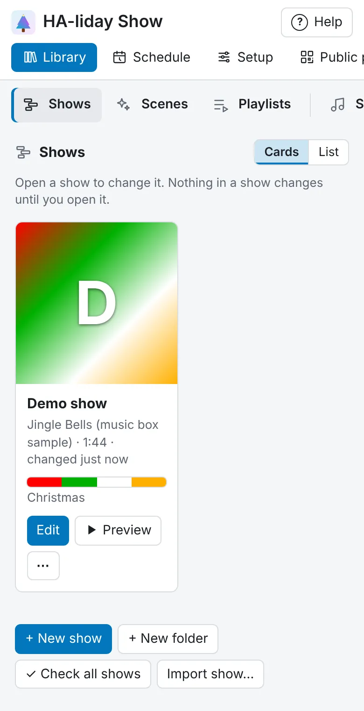

<!-- The user guide is written here, a page per topic. tools/check_guide.py checks its links. -->

# Your shows

Make, organise, share and export shows.

A show is a song plus effects on each light's track. The usual path is: pick a song, **Detect** its
beats and sections, then **Generate** a draft or **Describe it**, and fine-tune clips on the
timeline.

- **The song:** [Shows](#shows) · [Sharing shows](#sharing-shows) · [Songs](songs.md) · [Samples](songs.md#samples) · [Editing a song](music-editor.md#editing-a-song) · [Drafts](music-editor.md#drafts) · [Layers](music-editor.md#layers) · [Mashups](music-editor.md#mashups) · [Mixer](music-editor.md#mixer-bass-mid-treble-filter-tempo-and-key) · [Suggest cuts](music-editor.md#suggest-cuts) ·
  [Marks](music-editor.md#marks) ·
  [Detecting](music-editor.md#detecting-in-the-music-editor) · [Sections](music-editor.md#editing-sections) · [Beats](music-editor.md#beats)
- **Let it help:** [Suggestions](generate.md#suggestions) · [Describe it](generate.md#describe-it) · [Generate](generate.md#generate)
- **By hand:** [The timeline](show-editor.md#the-timeline) · [Adding effects](show-editor.md#adding-effects) ·
  [Editing a clip](show-editor.md#editing-a-clip) · [Transitions](show-editor.md#transitions) · [Settings that change over a clip](show-editor.md#settings-that-change-over-a-clip) · [Mixing lanes with the lights](show-editor.md#mixing-lanes-with-the-lights) · [Presets](show-editor.md#presets) · [Your own presets](show-editor.md#your-own-presets) ·
  [Copying](show-editor.md#copying) · [Colour palettes](show-editor.md#colour-palettes)
- **Odds and ends:** [Lights that are gone](show-editor.md#lights-that-are-gone) · [Working on one part](show-editor.md#working-on-one-part) ·
  [Undo](show-editor.md#undo) · [Shortcuts](show-editor.md#shortcuts)

## Shows

Your shows are under **Library → Shows**, and nothing changes in a show until you open it in the
**Show editor**. Each show is listed with its song, its length and when it last changed, newest first, and the
one you were last editing has a **Last edited** badge. Under that is the show's palette: a strip of its colours
and the palette's name.

**Library → Shows**, **Songs**, **Scenes**, **Pictures**, **Faces**, **Palettes** and **Presets** show their items as
cards: each show's picture or cover art (or its palette tile), each song's cover art, each scene's or palette's colours, each
picture or face, or each preset's moving preview, across the top, with its name and buttons under it. **Cards** and **List**, at the top right of each, switch between
cards and the shorter rows, and each remembers your choice in this browser. Folders stay full width
above the cards.

Once a show has a [season](organising-lights.md#seasons), buttons above the list pick which shows you see: **All**, or one
season, such as **Christmas**, which shows its shows and the ones for **Any season**, from every folder,
each saying which folder it's in. It says how many are shown, and remembers your choice in this browser.
Pick **All** to see everything again.

## Folders

Every Library list (**Shows**, **Scenes**, **Playlists**, **Songs**, **Samples**, **Palettes** and
**Presets**) has folders you go into, and folders can hold folders.

- A list shows its folders first, each with how much is in it, then what's in no folder. Press a
  folder to go into it; only what's in it shows. The path at the top (**Songs › Rock › Arctic
  Monkeys**) takes you back up, and so does the browser's **Back**. The list remembers the folder you
  were in.
- **+ New folder** (beside **+ New …**) makes a folder inside the one you're in. Anything you add or
  make while a folder is open (a new show, an uploaded song) goes in it, and a **Duplicate** goes in the
  same folder as the original.
- To move something, press **⋯ → Move to…** on it and pick a folder (or the top of the list), or drag
  its row onto a folder, or onto a name in the path to move it up. Folders move the same way, though
  never into themselves, and they go at most 8 deep.
- A folder's **⋯** has **Rename…**, **Move to…** and **Delete…**. Deleting a folder deletes nothing in
  it: what it held moves up a level.
- **Find** (on **Songs**) and the **Originals**, **Edits**, **Splits** and **Drafts** buttons search every folder;
  each match says which folder it's in, and pressing that goes there.

Folders only sort the lists: files stay where they are on disk, so shows and speakers still find their
songs. They're saved with your settings, so they're in **Export…** too.

- **Edit** a show to change it, or press **+ New show** to start one. A short window takes you through:
  1. the **song**: go into your song folders as in **Library → Songs**, or type in **Find a song in any
     folder**. Pick **No song, lights only** (at the top) to set a length instead, or press
     **+ Add a song…**.
  2. its **name**, which fills in from the song until you type your own. Each show needs its own name.
  3. its **colours**: a palette, shown as its colours, or **None** (see [The show's palette](#the-shows-palette)).
  4. with an AI set up, how it starts: **Start empty**, or **Generate with AI**, which needs a song
     and at least one light and shows the same choices as **✨ Generate** (in the show's palette: **Style**,
     **Feel**, **Build up**, **Longest effect** and, with lights traced on the house photo, the sweep across the
     house). Without an AI, there's no step 4 and the show starts empty. For a quick draft
     made by rules, press **✨ Generate** in the editor (see [Generate](generate.md#generate)).

  **Create show** (or **Create and generate**) saves it straight away; **Cancel** makes nothing.
- Each show's row has **Edit**, **▶ Preview**, and **⋯** for the rest: **Duplicate**, **Rename**, **Share**,
  **Export video…** (see [Making a video of a show](#making-a-video-of-a-show)), its
  **Move to…** (see [Folders](#folders)) and, last, **Remove…**. Rows elsewhere in the Library work the same
  way: their main button, then **⋯**.
- **▶ Preview**, beside **Edit**, plays the show on your house photo in a window, with its song.
  Nothing is sent to your lights. Under the house are the player controls: **⏮** back to the start, **⏪** and
  **⏩** back and on 5 seconds, **▶**/**⏸** to play and pause, a bar to jump to any point, and the volume. On a
  keyboard, Space plays and pauses, the arrow keys move 5 seconds and Home goes back to the start. **Edit** opens it.
  When visitors' phones join the show, or it has a **Phones** lane, a phone beside the house shows what their
  screens show as it plays (below the house on a narrow screen).
- **Making a video of a show**: **Export video…** in a show's **⋯** (or
  **🎬 Video…** in the Show editor's top bar) makes an MP4 of it playing on your house photo, as **▶ Preview**
  shows it, with its song, to post on YouTube, a forum or social media.
  - Pick **Landscape** (1920 × 1080) or **Upright** (1080 × 1920, for Shorts, Reels and TikTok), and **The
    whole show** or, from the Show editor with a [play region](show-editor.md#working-on-one-part) set, **The play region**
    for a short clip.
  - The video starts with the show's name (and its song's, if that's different), shows a bar along the
    bottom with the song's sections and beats moving as it plays, has a small "Made with HA-liday Show" in
    the corner, and ends with a three-second card with HA-liday Show's web address.
  - It's drawn and encoded in your browser, much faster than the show plays, then HA-liday Show adds the
    song and makes the MP4, which downloads by itself. **Cancel** stops it. Nothing is kept afterwards.
  - It needs a house photo (or the sample house) under **Setup → House**, with your lights traced to see them,
    and a browser that can make videos: Chrome, Edge and Safari can. A show open with changes is saved first.
    A Python install needs ffmpeg (the app and the Docker image have it).
- **In progress** or finished: a new show starts **In progress**, shown by a badge on its row, until you
  mark it finished with **Mark as finished** in its **⋯** menu (or untick **In progress** in
  **⚙ Show settings…**). **Mark as in progress** puts it back. Shows in progress still play everywhere
  you play them, but they aren't offered on the public page and visitors don't see them, even inside a
  playlist, so you can take one back to work on it without losing its place there. Shows you made before
  this existed count as finished.
- **On phones**: while **Let visitors' phones join the show** is on (under **Public page → Listening**), a
  show that visitors' phones follow has an **On phones** badge. A show you've taken off phones (untick
  **Phones join this show** in **⚙ Show settings… → Visitors' phones**) doesn't. Hover over the badge to
  see whether it has its own **Phones** lane or phones just show your lights' colour.
- **Duplicate** makes a copy called "… copy", ready to play straight away. The copy starts in progress.
- **Rename** lets you type a new name in the list; press Enter to keep it, or Escape to put it back.
  Each show needs its own name. An automation that starts the show by its name needs the new name.
- **Share** downloads the show as a file you can send to anyone with HA-liday Show (see [Sharing shows](#sharing-shows)).
- **Remove…** archives or deletes a show (see [Archiving and deleting](songs.md#archiving-and-deleting)).
- **← All shows**, at the start of the Show panel, takes you back to **Library → Shows**. Going to
  another tab instead keeps your show open, with **↩** at the top to come back to it (see
  [Finding your way](getting-started.md#finding-your-way)).

The Show panel shows the open show's name beside **← All shows**; to switch to another show, go back
to the list. **⚙ Show settings…** opens the show's settings: its **Name**, **In progress** (see [Shows](#shows)), its **Palette** (below), its **Picture** (see [Songs](songs.md)), its **Show speaker**
(below), **Brightness** (below), **Visitors' phones** (see [Phones join the show](visitors-phones.md#phones-join-the-show)), **Save automatically a couple of seconds after each change**, and **Remove show…** to archive or delete it.

## A song's colours

A song can have its own palette, picked from its cover art or the AI's ideas when you add it, from **Colours from this
song…** in its **⋯** menu under **Library → Songs**, or from **Colours…** in the Music editor's **Beats
and sections** panel. The palette you pick is kept with the song and added to your palettes (named after
the song), so you can edit or rename it under **Library → Palettes**. Picking again for the same song
changes that palette rather than adding another. The AI is told the song's name (put the
artist in it, such as "Wham! - Last Christmas", for the best ideas) and the cover's main colours, not
the picture itself; a song with no cover art still gets its ideas. A song file made from it in the Music editor (**Make song
file**) comes with its colours, as it does its cover art; once the made file has colours of its own,
making it again keeps them. When a **New show** picks the song, its palette is
picked for you in the colours step, marked **This song's colours**, unless you've already chosen
colours yourself in that window. Changing the song of a show you've already made doesn't change its
colours.

## The show's palette

Each show can have its own palette, picked in the **New show** window and changed in **⚙ Show
settings…**. In the **New show** window (and **+ New scene**'s colours step), your palettes are in your
folders from **Library → Palettes**, with the built-in ones after them; if the one picked is in
another folder, a line under the list says which. Effects you add take its colours, and the effect chooser previews every effect in them.
The palette picker under a clip's colours starts on it too; picking another palette there is just for
colouring that clip. Change the show's palette later and you're asked whether to recolour the effects
already in the show; say no and only new effects use it. **None** keeps each effect's own colours, as
shows made before this had. If you change the colours of one of your palettes, shows using it follow;
if you delete or rename it, they keep the colours it had (the open show follows a rename).

**Brightness** in **⚙ Show settings…** dims this show without changing any of its effects:

- **Whole show** dims every light in the show.
- **Each light in this show** has its own slider, so you can bring down one light that's too bright
  next to the others. A light split into parts is dimmed as one.

The two work together with each effect's own **Brightness %** on the timeline, and with each light's
brightness under **Setup → Devices**, which applies to every show. For example, a show at 50% with a
light at 50% plays that light at a quarter. The preview and the house photo show the result as you
drag. Shows you made before keep playing at 100%.

## Sharing shows

You can swap shows with friends, or post one on a forum, without either of you changing your lights.

- **Share** on a show's row downloads a small file ending in `.halidayshow`. It holds the show's effects,
  its beats and sections, its **Brightness** levels from **⚙ Show settings…**, the song's name and length,
  and a short description of each light it uses
  (its name, what kind of light it is, how many segments and parts it has, roughly where it is on
  your house photo, and the [seasons](organising-lights.md#seasons) it's a prop for). The show's season goes with it too. It doesn't hold the song, your house photo, IP addresses or any settings. Lights
  with no effects in the show are left out. Pictures used by its **Picture** effects go with it (up to
  20), and are added to your **Library → Pictures** when it's imported. A show with pictures needs
  HA-liday Show 0.2.282 or later to import. Your own [faces](pictures-and-faces.md#faces) used by its **Singing face** effects
  go with it too (up to 20), and are added to your **Library → Faces** when it's imported (one you
  already have, with the same name and look, is used as it is). In a copy older than 0.2.392 they show
  as snowmen.
- **Import show…**, beside **+ New show**, asks for a `.halidayshow` file, then opens a short window.
  It always makes a new show, so nothing you already have changes.
  1. **Name and song.** Songs aren't shared, so pick your own copy. The song with the closest name is
     picked for you. If your copy is a different length, a ⚠ says so: the show still imports, and you
     can move effects in the editor afterwards. You can also pick **No song for now** and add it later.
  2. **Match your lights.** Each light in the show has a row, with a small map of where it was on their
     house. Pick which of your lights plays it. Your lights are suggested for you, most alike first,
     and each suggestion says why, such as "✓ Suggested: same model, 3 parts each". A light that isn't
     much like any of yours starts on **Leave it out**, and its effects don't come across.
     - Effects stretch to fit your light, however many bulbs it has.
     - A light with parts shows a **Parts** box, so you can pick which of your light's parts plays each
       of theirs, or **Whole light**.
     - Two of their lights can play on one of yours: the picker says "(also playing …)". Where both
       have an effect at the same time, the one that started later shows.
     - Effects across the whole house, on the **House** lane, always come along.
     - **▶ Preview on your house** plays the show on your house photo, with the pairings as they are
       now and your song in this browser, so you can see it before you import it. Change a pairing
       while it plays and the preview follows. Nothing is sent to your lights, and nothing is saved.
       Press **■ Stop preview** to stop it. It needs your lights on the house photo
       (**Setup → House**).

  The show's **Brightness** comes along: the whole-show level as it was, and each light's level on
  the light of yours that plays it. Where two of their lights play on one of yours, the brighter level
  is used. You can change them afterwards in **⚙ Show settings…**. A show shared from an older
  HA-liday Show, before brightness, imports at 100%.

  **Seasons** come along by name. A Halloween show becomes a Halloween show if you have a season called
  Halloween (otherwise it's for any season, and a note says so). Their Halloween props are suggested for
  your Halloween props, and their all-year lights for your all-year ones; the match screen says which of
  their lights are props.

  **Matrices** come along with their size. Their matrices are suggested for your matrices, and their
  mega-trees for your mega-trees. When the sizes differ, the match screen says their matrix effects
  stretch to fit, and when you pick a strip for one, it says those effects show only a slice there.

  **Import show** saves it and opens it in the editor. Effects a light can't show are marked as usual
  (see [Effects a light can't show](show-editor.md#effects-a-light-cant-show)).

<!-- nav: made by tools/check_guide.py -->

---

← [Pictures and faces](pictures-and-faces.md) · [Contents](README.md) · [Let it make a show for you](generate.md) →
<!-- /nav -->
