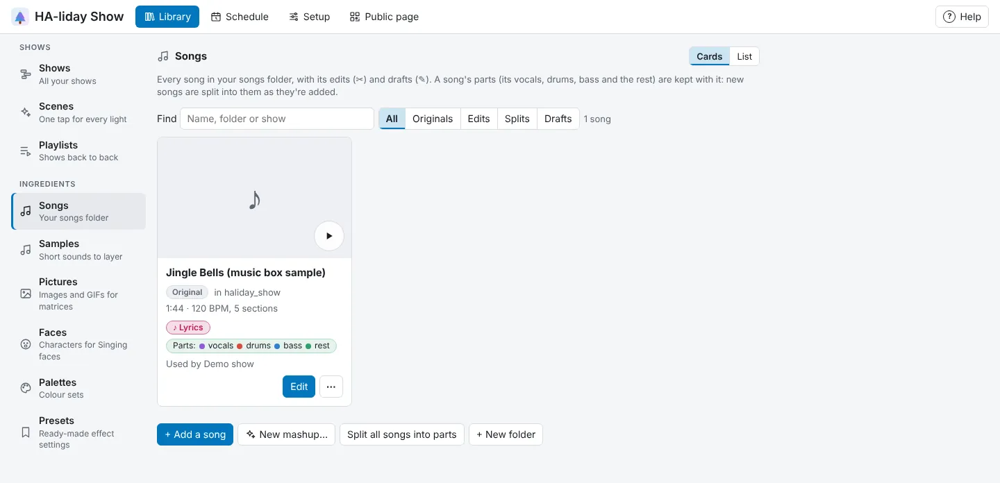

<!-- The user guide is written here, a page per topic. tools/check_guide.py checks its links. -->

# Songs and samples

Add songs, split them into their parts, and keep short sounds to layer.

The Song panel shows the show's song with its length, tempo and sections, and, once HA-liday Show has
listened to it, what can be heard in it (see [Split into parts](#split-into-parts)). Press
**Change…** to pick another from your Home Assistant **media** folder: the window shows your folders from
**Library → Songs**, opening on the one the show's song is in (or the top, for a lights-only show), and
**Find a song in any folder** searches them all. Or press **+ Add a song…** (MP3,
M4A, AAC, OGG, Opus, WAV, FLAC or WebM; see below). Songs you add go to `/media/haliday_show/` so media
players can play them. For a lights-only show, choose **No song, lights only** and set its **Length with no song**.

**Library → Songs** lists every song in your media folder: its length, what **Detect** found (its
tempo and sections) or "not detected yet", and which shows use it. Under that, a strip of colours with a palette's name shows the colours kept with it (press it to pick
again; see [A song's colours](shows.md#a-songs-colours)), a pink **♪ Lyrics** pill shows it has
its words. An edit cut from a song with words shows it too, as its shows use the song's words
(a mashup only shows it if it has words of its own), and **Parts:** with a coloured dot for each part shows it's been split into its vocals, drums,
bass and the rest (the same as in the Music editor). Type in **Find** to narrow the
list by name, folder or show. **Edit** opens a song in the **Music editor**, and **Remove…** archives
or deletes one. The song you last opened in the Music editor has a **Last edited** badge.
**▶** beside a song, an edit or a split plays it there and then, in a bar along the bottom of the page:
**⏸** pauses, the slider jumps to any point, and **✕** stops it. It stops when you leave **Songs**.
A song with cover art (from an MP3, M4A or FLAC's own tags) shows it beside its name, and beside the
shows that use it in **Library → Shows**. To give a show a picture of its own, use **Picture** in its
**⚙ Show settings…**: **Upload picture…** takes any photo or image, squares it from the middle, and uses it
instead of the song's cover art, here and on the public page (with any hidden details, such as where a
photo was taken, taken out). **Remove** goes back to the song's cover art. A show with neither gets a
tile in its palette's colours with its first letter. Songs are kept exactly as you added them, so their cover art,
title and artist are never lost.

Each song you added is one card, marked **Original**. Inside it, under **Edits of this song**:

- **✂ Edit · song file** (purple): a song file made in the Music editor from this song, with its length,
  the shows that use it and the [draft](music-editor.md#drafts) it was made from. **Edit draft** reopens that draft. Under **⋯**:
  **Rename…** renames the song file (shows, drafts and folders that use it follow), **Duplicate**
  makes a new draft from its draft, to take another way and make its own file, and **Remove…** archives
  or deletes the file (the draft stays). An edit of an edit sits under the first
  song. Edits made before drafts existed (named "… (edit)") are found by their name; **Edit** on one
  starts a new draft.
- **✎ Draft · no file yet** (amber, dashed): a draft that hasn't made a song file, so shows can't use
  it yet. **Edit** it, or under **⋯**, **Rename…**, **Duplicate** or **Delete…** it.
- Songs in HA-liday Show's own folder have **Rename…** and **Duplicate** (a copy of the file,
  "… copy") under **⋯** too. Renaming one that's still open in
  the Music editor puts it away there first, once your last change is kept.

**All**, **Originals**, **Edits**, **Splits** (splits from before songs kept their parts, that
couldn't be matched to their song) and **Drafts**, beside **Find**, show just those, and the count says
how many songs, edits, splits and drafts there are.

**Folders** sort your songs, such as **Christmas**, **Halloween** or **Party**, and work as in every
Library list (see [Folders](shows.md#folders)). A song's edits and drafts go with it.

**+ Add a song**, under the list, opens a short window:

1. **Choose a file…** and give it a **Name**. It's saved under that name in `/media/haliday_show/`; if
   a song there already has it, the window asks for another, so nothing is replaced by mistake.
2. How to get it ready, then press **Add song**:
   - **Detect, then let the AI name the parts** (picked to start with when an AI is set up): finds its
     tempo, beats and parts, then the AI names the parts and writes their notes a little later (see
     the section notes under [Detecting in the Music editor](music-editor.md#detecting-in-the-music-editor)).
   - **Detect only** (picked to start with without an AI): the same, with the simple notes.
   - **Add it as it is**: leaves it for later (**Detect** in the Music editor).

   Detected songs are ready to use: a show that picks one gets its beats and parts straight away.

Then a **Colours from this song** window follows, if there's something to offer: a palette made from
the cover's main colours, made bright for lights (black, greys and whites are left out, as they look
like "off" or dull on lights), and, with an AI set up, up to two palettes from the AI that suit the song
(listed under **From the song** when they arrive; a spinner shows while the AI works, and after a few
seconds how long it's taken, as it can take up to a minute). Press **Use these** on the one you
want, or **Skip**. See [A song's colours](shows.md#a-songs-colours).

The same window opens from **+ Add a song…** in the **New show** window and in a show's **Choose a
song** window, and the song comes back picked.

Songs of any size up to 200 MB can be added. Home Assistant won't pass on more than 16 MB at once, so
a bigger song goes up in pieces, with the window showing how far it's got. Long shows on lots of
bulbs are saved in pieces the same way. If something goes wrong
while a window is open, the message shows inside the window as well as at the top.

## Archiving and deleting

**Remove…**, on a show or a song, opens a window that says where it's used and offers two ways to
take it away:

- **Archive** keeps it, out of the way. Archived shows and songs are listed, folded, under **Archived
  shows** and **Archived songs** at the foot of each list, and **Restore** brings one back.
- **Delete for good…** removes it, after asking you once more. Before it does, HA-liday Show keeps a copy
  of your shows and settings under **Setup → Your data** (*Before deleting*). A deleted song
  file itself can't be brought back.

**Shows.** An archived show is skipped by playlists (they show it as *archived*) and can't be started
by an automation, and comes back to the same places in its playlists when you restore it. If another
show has taken its name meanwhile, it comes back as "… (restored)". Deleting a show for good also
takes it out of its playlists. Archived shows are included in **Export…**. A show that's playing when
you archive or delete it plays to the end; a playlist skips it from then on. An archived show can't be
edited from another browser that still has it open until you restore it.

**Songs.** Only songs in HA-liday Show's own folder (`haliday_show` in your media folder, where uploads
and the Music editor's saves go) can be archived or deleted here, as the rest of your media folder
may belong to other apps; **Remove…** is greyed out for the others. If shows use the song, choose what
they play instead: **Another song** (press **Change…** to pick it from your folders), or **No song for now** (they keep their effects and beats, and
play the lights only). An archived song moves to an **Archived** folder inside HA-liday Show's
folder, where it's out of HA-liday Show's song lists but still in Home Assistant's Media. Restoring it
puts it back and gives it back to the shows that were left without a song.

## Split into parts

**Split into parts…** (under a song's **⋯** in **Library → Songs**, or in the Music editor's **Song**
panel, which shows **Parts:** with each part's colour once it has them, and **Split again…** to make them afresh) separates a song into its **vocals**, **drums**, **bass** and **the rest** of the music, and
keeps them with the song as its **parts**, along with the **music** (everything but the vocals). They
aren't songs of their own: the song's row shows them the same way, **Parts:** with each part's colour,
and they go wherever the song goes (renamed, copied, archived or deleted with it).

- **Singing faces** follow the vocals part.
- **Drum hits:** from the drums part, HA-liday Show finds when each kick, snare, hi-hat and crash
  lands. In the Music editor they show as small marks along the bottom of the waveform: red for kicks,
  blue for snares and gold for crashes. [Generate](generate.md#generate) uses them to put flashes on the real
  hits rather than every beat.
- **What can be heard in it:** once its parts are made, HA-liday Show listens to the whole song with a
  fourth, small AI (Google's YAMNet, which knows hundreds of kinds of sound) for **sleigh bells**,
  **bells and chimes**, **xylophone and vibes**, a **choir**, **brass**, **strings and orchestra**,
  **piano**, **organ**, **guitar**, **synthesiser**, **woodwind**, **harp**, **whistling** and
  **clapping**, and for how it sounds: **happy**, **sad**, **tender**, **exciting**, **angry**,
  **scary** or **Christmassy**. It takes seconds. The show's **Song** panel then says what it heard,
  such as "Heard: Sleigh bells, Choir · sounds happy", and [Generate](generate.md#generate) picks looks to suit
  each part of the song.
- **Layers** in the Music editor can play any song's parts: press **+ Add a clip…**, pick the song under
  **Songs**, then choose **Just the vocals**, **Just the drums** and so on under **Use from**. Use the
  music as a backing track, the drums under another song, or the vocals over another song for a
  mash-up. Splicing a song in (**Add another song → Choose song…**) offers its parts the same way.
- **Edits** use their original song's parts through your cuts, so there's no need to split an edit.
  When you make a song file from a draft, its parts (and its drum hits) are cut from the original's the
  same way, in seconds, with no AI. Your EQ and layers go into them too: a layer of just another song's
  vocals goes into the new file's vocals, a whole song layered on adds each of its parts to the matching
  part, and a sample (or a song not split yet) goes into the rest of the music. Where a layer quietens
  the song, every part dips with it.

**New songs are split by default.** When you add a song (**+ Add a song**), the window stays open
while it gets the song ready, with a line for each thing it does and its own percentage: added (and
its beats and sections found), its section notes (when an AI or the notes model writes them), its
vocals, drums and bass found (saying whether that's on your graphics chip or the slower processor), its
parts kept, listening for the sounds in it, and its words lined up if you pasted them.
It takes several minutes. **Stop** stops it, keeping whatever's done, and **Done** closes the window
when it's finished. On a slower computer, turn off **Split it into parts** in the second step of
**Add a song** to leave that for later: the song is then only listened to (see below), which takes
seconds, and **Split all songs into parts** splits it whenever suits you, overnight say. **Add a
song** remembers your choice for next time.

**Words** in the second step of **Add a song** is optional: paste the song's words, one line of the song
per line, and they're kept with the song (a **♪ Lyrics** badge shows on its row). Once it's split, they're
lined up with the singing, as **Line up with the singing** does under [Lyrics…](effects.md#lyrics-for-a-singing-face).
Left unsplit, they're placed roughly across the song. When it's done, **Check the words…** opens the
**Lyrics…** window to check every line (or, if they were only placed roughly, to pick a better way to place
them), and if you didn't paste any, **Add words…** opens it to paste them.

When songs are split another way (**Split all songs into parts**, or **Split into parts…** on one), a bar above your songs in **Library → Songs** says which song
it's on and how far along it is, and the line at the bottom of the page says so on other pages too.
You can carry on using HA-liday Show meanwhile, but keep the page open until it's done. **Stop** stops
it; parts already made are kept. If the connection drops part way (the Wi-Fi blips, or the app restarts
after an update), it waits and tries again for about a minute before giving up on that song; if it does
give up, it says it lost touch, and **Split into parts…** on that song tries again. A song cut off part way as it
downloads to your browser carries on from where it got to.

**Split all songs into parts** (under the list in **Library → Songs**) does the same for every song
that isn't split yet, one after another, and listens to any song split before HA-liday Show listened
to songs (seconds each, with no question asked if that's all there is to do). An edit made from a draft of a song that's split has its
parts cut from the original's in seconds, rather than split again. A file made from a draft with layers or EQ
before 0.2.412 has parts without them: open its draft and press **Make song file** again to put them in,
in seconds. Anything not done when you close
the page is picked up next time you press it.

An edit doesn't need splitting on its own: it gets its parts from its original song. Once the
original is split, its edits get their parts cut from it automatically, in seconds, whenever
**Library → Songs** is open (an edit with layers or other songs spliced in is the exception: use its
**⋯ → Split into parts…**). An edit's **⋯** says **Get parts from the original** to do it straight away,
or **Split the original into parts…** while the original isn't split yet. **Split all songs into
parts** counts only the songs that need the AI, splits them first, then cuts their edits' parts.

A song you split before (with Split vocals) has its vocals already: **Split into parts…** keeps them
and only finds the drums, bass and rest. Each part is kept as soon as it's ready, so if you stop part
way, the parts it finished are kept.

Parts are kept in a hidden **.parts** folder inside HA-liday Show's songs folder (**haliday_show** in
your media folder), as WAV files: each is about 10 MB a minute of song, so a three-minute song's parts
take about 150 MB.

Songs you split before songs had parts ("Jingle Bells (vocals)" and "Jingle Bells (music)")
were moved into their song's parts when you updated, and shows and drafts that used them follow. Any
that couldn't be matched to a song (its song's gone, say) stay as songs, under **Splits**.

Three AI models do it, in your browser, on the song as it is (not a draft's edits): one for the vocals,
then one each for the drums and the bass, and a fourth listens to it. The first time, HA-liday Show downloads them (about 145 MB),
checks them, and keeps them until HA-liday Show restarts (they're never in your backups); your browser
then takes them from there, in pieces, and keeps its own copy where it can.
It's quickest on a computer whose browser can use the graphics chip (recent Chrome or Edge): a few
minutes for a song. The rest of the work around the AI is shared across your computer's cores, so
the graphics chip isn't kept waiting. The window says where it's running: **on the graphics chip**,
or **on the processor**, which can take a long time, several times as long as the song for each part,
so leave the page open and come back. If the graphics chip runs out of memory part way, it carries on on
the processor and says so: close other apps and browser tabs, then split again. Songs with clear lead vocals split
best; backing singers and effects can stay in the music, and a little of the music in the vocals.

While it works, a window covers the page saying what it's doing (downloading the AI, finding each part)
and how far along it is. **Cancel** stops it; the song is never changed. If the AI can't be downloaded,
the window says why, and HA-liday Show's log (in Home Assistant, the app's **Log** tab) says more.

## Samples

**Library → Samples** keeps short sounds, such as sleigh bells, a "ho ho ho" or a voice saying "Merry
Christmas", ready to layer over a song in the Music editor. There are two ways to make one:

- **From a song:** in the Music editor, select the stretch you want and press **Save as sample…** (in
  the **Selection** panel), pick which sound, then give it a name. **As you hear it** keeps it as it
  sounds in your edit, layers and all. A song that's been split into parts also offers **Just the
  vocals**, **Just the drums**, **Just the bass** and **Just the rest** (a drum fill, or a sung line on its
  own; the part as it is, even if you've muted or turned it down in the **Mixer**), and while you're editing a layer on its own, **Just Choir** (or whatever it's called) keeps just
  that layer.
- **From a file:** press **+ Add a sample** and pick one or more files (the same kinds as songs).

They go in a **Samples** folder inside `/media/haliday_show/`, kept out of **Library → Songs** and a show's
song list so those stay tidy. Use them on a [layer](music-editor.md#layers) in the Music editor. Each sample has **▶** to hear it (press **■** to stop), and under **⋯**, **Rename…**, **Duplicate**
(a copy, "… copy") and **Delete…** to remove it for good. Layers that use a renamed sample follow it.

To sort them, use folders (see [Folders](shows.md#folders)). The files themselves stay where they are, so
songs that use them still find them. In the Music editor, a layer's **+ Add a clip…** window shows the
samples in their folders.

<!-- nav: made by tools/check_guide.py -->

---

← [Your house](house.md) · [Contents](README.md) · [The Music editor](music-editor.md) →
<!-- /nav -->
