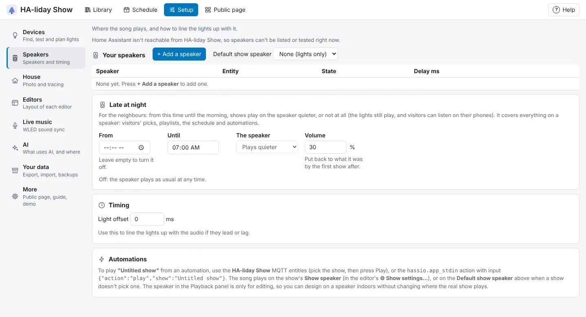

<!-- The user guide is written here, a page per topic. tools/check_guide.py checks its links. -->

# Speakers

Where the music plays.

The song can play on any Home Assistant media player that can play files from the media folder.
Speakers are added on the **Speakers** tab first, and only those are offered in the editor.

- Press **+ Add a speaker**, then **Test and add** next to a media player in the window that opens
  (type in **Find a speaker** to narrow a long list). HA-liday Show plays a short chime on it the same way
  a show starts and only adds it if that works. Media players that can't be sent a song are listed
  but can't be added, and a failed test shows Home Assistant's reason. Echo devices through Alexa
  Media Player and Emby clients, for example, often can't play files from the media folder.
- **Delay ms** is how late the speaker really starts after it reports playing. Raise it if the
  lights run ahead of the music (often 100 to 500 ms for Wi-Fi speakers).
- **Default show speaker** is where shows play when started from an automation, unless a show picks
  its own (see [Play it](playing.md)).

## Late at night

For the neighbours. Under **Late at night**, set **From** (empty means off) and **Until** (07:00 to start
with), then what **The speaker** does in between:

- **Plays quieter**, at the **Volume** you set (30% to start with). HA-liday Show remembers how loud the
  speaker was and puts it back for the first show after **Until**. (After a restart in between it can't,
  so set the volume yourself.)
- **Stays silent**: shows play on the lights only. Visitors can still listen on their phones.

It covers everything that plays on a speaker: visitors' picks, playlists, the schedule and automations.

<!-- nav: made by tools/check_guide.py -->

---

← [Parts, groups, roles and seasons](organising-lights.md) · [Contents](README.md) · [Your house](house.md) →
<!-- /nav -->
