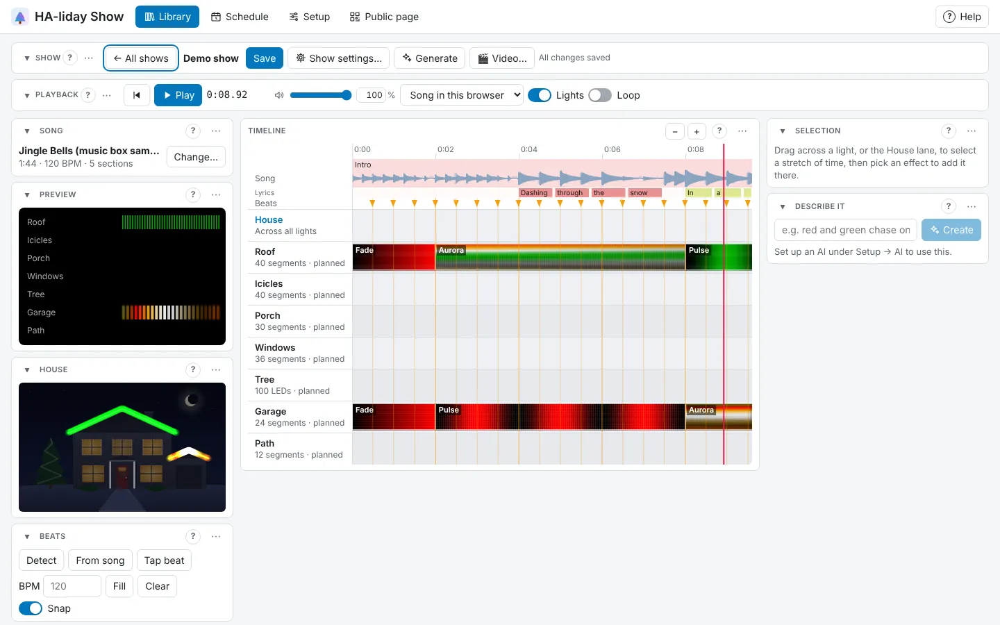

# 🎄 HA-liday Show

Build music-synchronised light shows for your Christmas lights, preview them on a photo of your house,
and play them from Home Assistant. It drives WLED strips, pixel controllers (DDP or E1.31), Govee
lights, any Home Assistant light or switch, and Twinkly (experimental), in any mix. Open **HA-liday Show**
from the Home Assistant sidebar.

**The full user guide is on GitHub, a page per topic: [open the user guide ↗](https://github.com/gdeboos/ha-liday-show/blob/main/docs/guide/README.md).**
Inside HA-liday Show, **? Help** at the top right has tips for the page you're on, each with a link to the
right part of the guide.

## Quick start

The first time you open HA-liday Show, the **setup guide** walks you through it in one window: add your
lights, check each one, pick a speaker, choose the sample house or your own photo, and make your first
show from a song. Run it again any time with **Run the setup guide** under **Setup → More**.

No lights up yet? Press **Try the demo** on the setup guide's first page (or under **Setup → More → Demo**):
it adds seven planned lights on a sample house, a sample song and a demo show, so you can try everything
without sending anything to real lights.

To do it by hand:

1. **Setup → Devices**: press **+ Add a light**, pick what kind it is and follow the steps, then **Test** it.
2. **Setup → Speakers** (optional): **+ Add a speaker**, then pick it as the default show speaker.
3. **Setup → House** (optional): upload a photo of your house and trace each light on it.
4. **Library → Shows**: press **+ New show**, pick or upload a song, name it, pick its colours and press
   **Create show**. Drag across a light's track, press **＋ Add effect…** and pick one. Press Space to play.
5. **Schedule**: press **+ Add to schedule** to have it play by itself, or start it from Home Assistant.

## What you need

- Home Assistant OS or Supervised (anything with **Settings → Apps**). No apps? HA-liday Show also runs
  [with Docker or Python](https://github.com/gdeboos/ha-liday-show/blob/main/docs/guide/without-home-assistant.md).
- Lights on the same network as Home Assistant: WLED, DDP or E1.31 pixel controllers, Govee lights with
  **LAN Control** on, Home Assistant lights and switches, or Twinkly.
- Optional: a Home Assistant media player for the music. Without one, songs play in your browser while
  you edit, and visitors can listen on their own phones.

## The guide

| | |
|---|---|
| **Start here** | [Getting started](https://github.com/gdeboos/ha-liday-show/blob/main/docs/guide/getting-started.md) |
| **Set up, once** | [Adding your lights](https://github.com/gdeboos/ha-liday-show/blob/main/docs/guide/lights.md) · [Parts, groups, roles and seasons](https://github.com/gdeboos/ha-liday-show/blob/main/docs/guide/organising-lights.md) · [Speakers](https://github.com/gdeboos/ha-liday-show/blob/main/docs/guide/speakers.md) · [Your house](https://github.com/gdeboos/ha-liday-show/blob/main/docs/guide/house.md) |
| **Songs** | [Songs and samples](https://github.com/gdeboos/ha-liday-show/blob/main/docs/guide/songs.md) · [The Music editor](https://github.com/gdeboos/ha-liday-show/blob/main/docs/guide/music-editor.md) · [Pictures and faces](https://github.com/gdeboos/ha-liday-show/blob/main/docs/guide/pictures-and-faces.md) |
| **Make shows** | [Your shows](https://github.com/gdeboos/ha-liday-show/blob/main/docs/guide/shows.md) · [Let it make a show for you](https://github.com/gdeboos/ha-liday-show/blob/main/docs/guide/generate.md) · [The Show editor](https://github.com/gdeboos/ha-liday-show/blob/main/docs/guide/show-editor.md) · [Effects](https://github.com/gdeboos/ha-liday-show/blob/main/docs/guide/effects.md) |
| **Play them** | [Playing shows and playlists](https://github.com/gdeboos/ha-liday-show/blob/main/docs/guide/playing.md) · [Scenes](https://github.com/gdeboos/ha-liday-show/blob/main/docs/guide/scenes.md) · [Live music](https://github.com/gdeboos/ha-liday-show/blob/main/docs/guide/live-music.md) · [Schedule](https://github.com/gdeboos/ha-liday-show/blob/main/docs/guide/schedule.md) · [Pre-show check](https://github.com/gdeboos/ha-liday-show/blob/main/docs/guide/pre-show-check.md) |
| **Visitors** | [The public page](https://github.com/gdeboos/ha-liday-show/blob/main/docs/guide/public-page.md) · [Visitors' queue and voting](https://github.com/gdeboos/ha-liday-show/blob/main/docs/guide/queue-and-voting.md) · [Visitors' phones](https://github.com/gdeboos/ha-liday-show/blob/main/docs/guide/visitors-phones.md) |
| **Home Assistant** | [Home Assistant](https://github.com/gdeboos/ha-liday-show/blob/main/docs/guide/home-assistant.md) · [Dashboard cards](https://github.com/gdeboos/ha-liday-show/blob/main/docs/guide/dashboard-cards.md) |
| **Settings and help** | [Settings and your data](https://github.com/gdeboos/ha-liday-show/blob/main/docs/guide/settings.md) · [Setting up the AI](https://github.com/gdeboos/ha-liday-show/blob/main/docs/guide/ai.md) · [Troubleshooting](https://github.com/gdeboos/ha-liday-show/blob/main/docs/guide/troubleshooting.md) · [Running without Home Assistant](https://github.com/gdeboos/ha-liday-show/blob/main/docs/guide/without-home-assistant.md) · [Labs](https://github.com/gdeboos/ha-liday-show/blob/main/docs/guide/labs.md) |

## Something wrong?

**Report a problem…** at the bottom of the **? Help** panel fills in the details for you (no names or
addresses) and opens an issue on GitHub. See also
[Troubleshooting](https://github.com/gdeboos/ha-liday-show/blob/main/docs/guide/troubleshooting.md).
What's new in each update is on the **Changelog** tab.
